# Advent of Cyber 1 [2019]


# Task 1: Introduction

Just before the lead up to Christmas, Santa’s company(The Best Festival Company) has been compromised by his nemesis(The Christmas Monster). Luckily, one of Santa’s elf team have a background in security. Can they recover all their systems before the lead up to Christmas?

It’s the evening of 30th November - the air in the arctic circle is filled with excitement, as every year. This year has been even smoother than previous years - Santa’s digitalisation program has made lives easier for everyone in the company. Elf McElferson, the CTO of the arctic circle, starts doing a couple of last minute checks; **everything has to be operating successfully running up to Christmas.** With her warm hot chocolate next to his desk, all she needs to do is open the health dashboard and grin at all the green lights. She enters the URL on the dashboard and leans in closer to the screen, anxiously waiting for confirmation. The page loads faster than expected and she gets the initial glimpse of all green. **Wait, the first indicator moves to red, and every other one follows the same.**

In less than a minute, she and all her colleagues receive the following email:

`Hey Crew!

We know that this is the busiest time of your year. 
What a shame though - it looks like all of you are locked out of your systems and can’t do any work. 

Boo hoo for Christmas

Santa’s Fav Nemesis,
Christmas Monster`

McElferson jumps out of her seat and yells. *This cannot be happening.* How is she supposed to fix this - it’s only 25 days till Christmas and no one can do anything. She goes to the only person who knows about security on his team, Elf McSkidy(you), and asks them to use their l33t skills to fix this. **They clearly have a big task ahead of themselves.**

---

A new task will be revealed ever day, where each task will be independent from the previous one. These challenges will cover the following 
topics:

- Linux Security
- Web Application Security
- Network Security
- Reverse Engineering
- Forensics

The challenges are designed for beginners and assume no previous knowledge of security. For more information on Prizes, Swag and event details please check out the [Christmas page](https://tryhackme.com/christmas).

By completing these challenges, you give your consent to give your email to CompTIA (the competition sponsors)

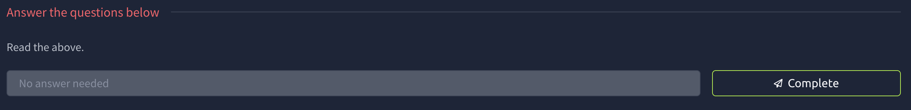

---

# Task 2: Connect To Our Network

When you deploy a machine on TryHackMe, you will need to be connected to our network using an OpenVPN client.

For information on connecting to our network and downloading your connection pack can be found on the [access page](https://tryhackme.com/access).

If you have problems connecting, please email us or ask on the [Discord](https://discord.gg/GzVZtGX)!

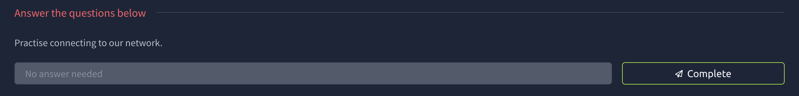

---

# Task 3: Points don't matter

In this competition, points <u>do not</u> matter. Your leaderboard rank will not affect you.

For each task you get correct, you get a 
raffle ticket. On the 26th December we will choose the winners randomly 
using everyone's raffle tickets.

Also, everyday you complete a challenge, you get entered into another prize draw, for the chance to win a mini-prize. The 'Daily Prizes' are done at the end of the week.

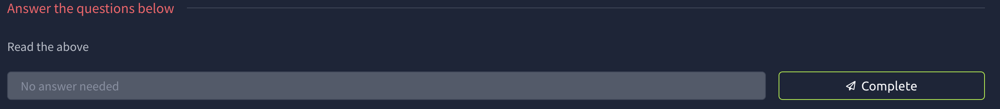

---

# Task 4: Our Socials


Be a part of our growing community and join our discord!


Follow us on Twitter to receive daily challenge posts.

We will choose a random winner everyday, to enter simply complete the challenge released on that day. All winners will be announced via Twitter.

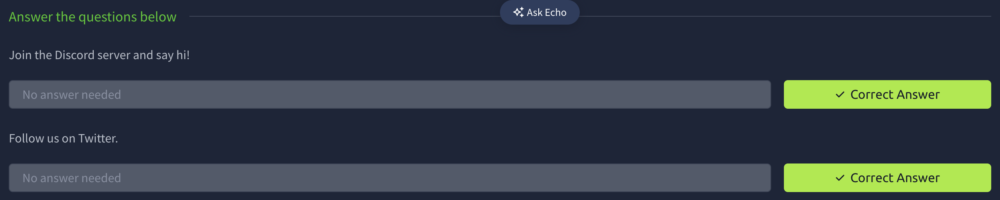

---

# Task 5: [Optional] Your own Kali Linux Machine


If you don't have the right desktop environment or security tools on your computer, you can deploy and access your own [Kali](https://tryhackme.com/room/kali) Linux machine directly in your browser. This also removes the need to be connected to our OpenVPN server!

*You need to be subscribed to do this.*

If you don't want to subscribe, each task will run through the tools needed and how to set them up on your local machine.

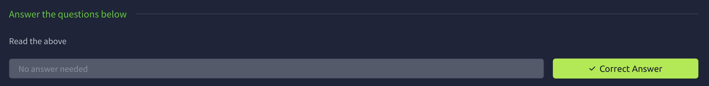

---

# Task 6: [Day 1] Inventory Management


Elves needed a way to submit their inventory - have a web page where they submit their requests and the elf mcinventory can look at what others have submitted to approve their requests. It’s a busy time for mcinventory as elves are starting to put in their orders. mcinventory rushes into McElferson’s office.

*I don’t know what to do. We need to get inventory going. Elves can log on but I can’t actually authorise people’s requests! How will the rest start manufacturing what they want.*

McElferson calls you to take a look at the website to see if there’s anything you can do to help. Deploy the machine and access the website at **http://<your_machines_ip>:3000** - it can take up to 3 minutes for your machine to boot!

Supporting material for the challenge is [here](https://docs.google.com/document/d/1PHs7uRS1whLY9tgxH1lj-bnEVWtXPXpo45zWUlbknpU/edit?usp=sharing)!


So we go into the website and inspect the cookie to see the name

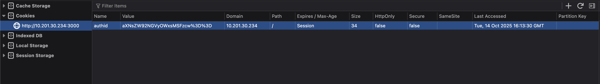

ANSWER: authid


First i wen to a decoder online and put the value. Which it gave me the same value but instead of %30%30 → == which makes me think of base64. So i ran that through cyberchef and i got isleov4er9ll1!ss. Isleo is the username so the fixed part is the <u>v4er9ll1!ss.</u>


Since we know how to encode and decode the cookie we can use this  to create or own cookie

mcinventoryv4er9ll1!ss → bWNpbnZlbnRvcnl2NGVyOWxsMSFzcw%30%30

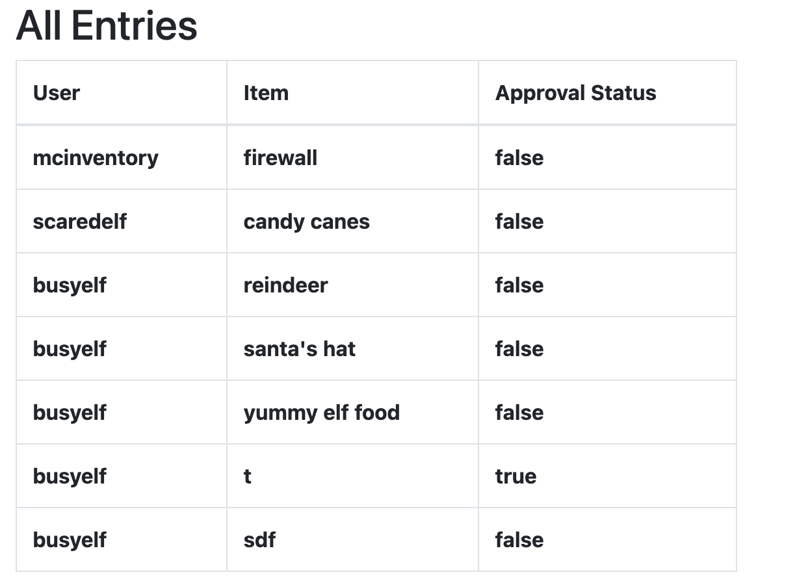

---

# Task 7: [Day 2] Arctic Forum


A big part of working at the best festival company is the social live! The elves have always loved interacting with everyone. Unfortunately, the christmas monster took down their main form of communication - the arctic forum!

Elf McForum has been sobbing away McElferson's office. *How could the monster take down the forum!* In an attempt to make McElferson happy, she sends you to McForum's office to help.

**P.S. Challenge may a take up to 5 minutes to boot up and configure!**

Access the page at http://MACHINE_IP:3000


We are currently doing this room in 2025 so im more familiar with dirb. so lets run that and see what we find. 

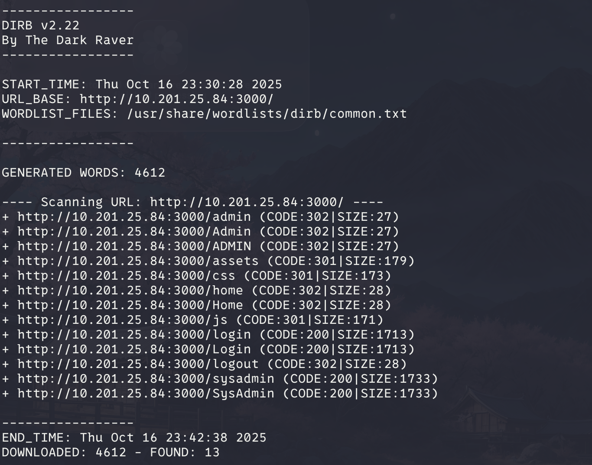

So we got sysadmin lets look at what we find.

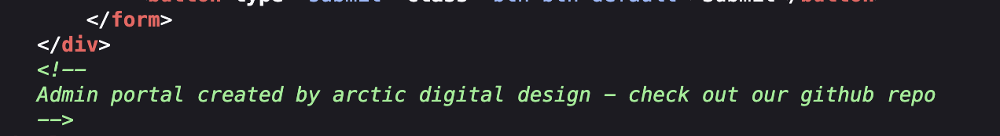

So we see this comment and go into the github to see if they have default login.

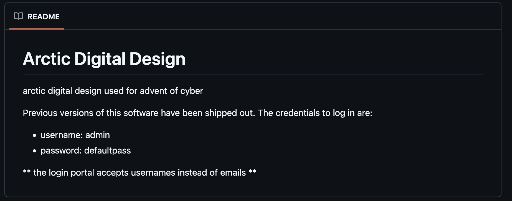

Once you login you will see what you need to bring to the partay!

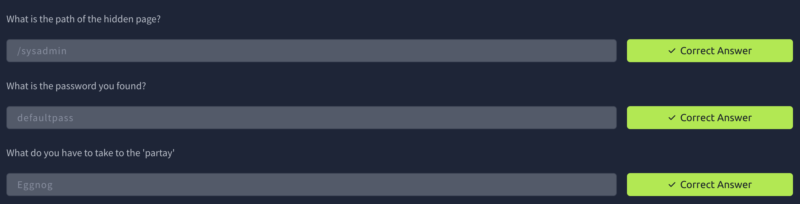

---

# Task 8: [Day 3] Evil Elf


An Elf-ministrator, has a network capture file from a computer and needs help to figure out what went on! Are you able to help?

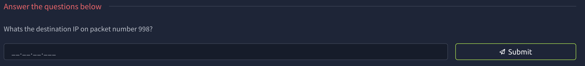

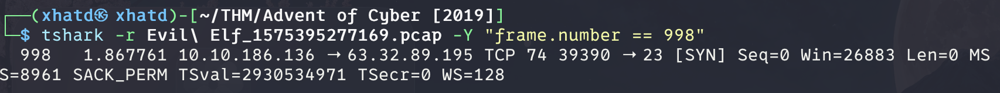

we see that the dest ip is **63.32.89.195.** So now we are going to see where that ip has been

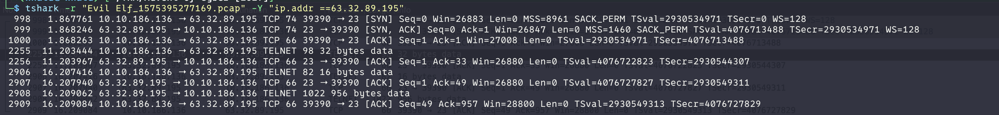

so we check the telnet packets first.

```bash
tshark -r Evil\ Elf_1575395277169.pcap -Y "frame.number == 2255" -V -x
```

-V for verbose 

-x for hex/ascii

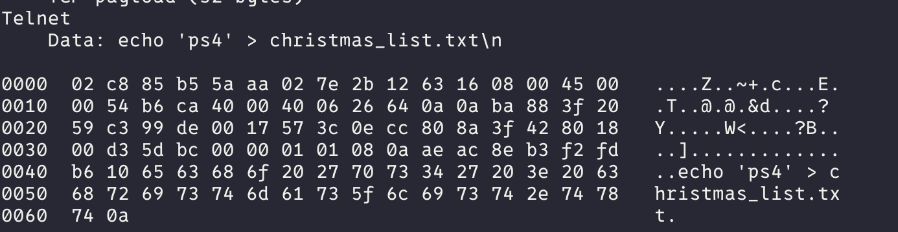

**Question 2: ps4**

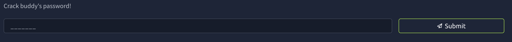

im guessing we will see it on the other packets

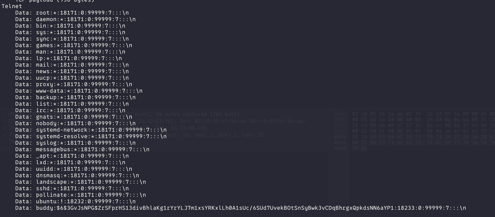

now we are going to have to crack the hash

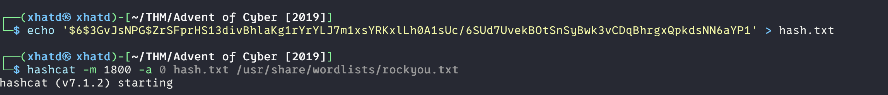

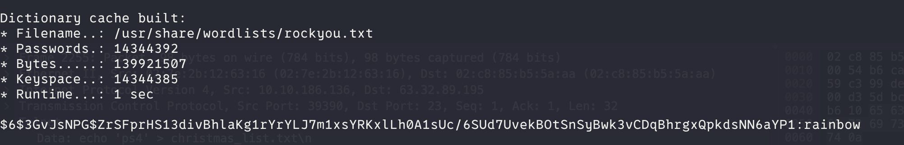

---

# Task 9: [Day 4] Training


With the entire incident, McElferson has been *very* stressed.

*We need all hands on deck now*

To help resolve things faster, she has asked you to help the new intern(mcsysadmin) get familiar with Linux.

Access the machine via SSH on port 22 using the command

ssh mcsysadmin@[your-machines-ip]

username: mcsysadmin

password: bestelf1234

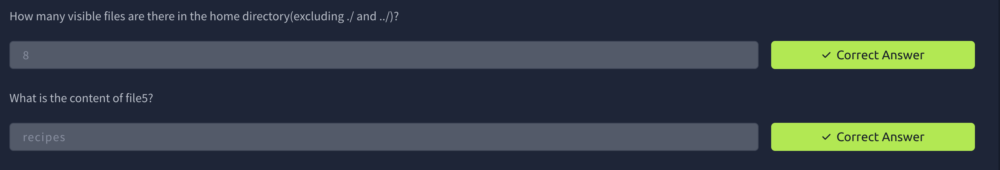

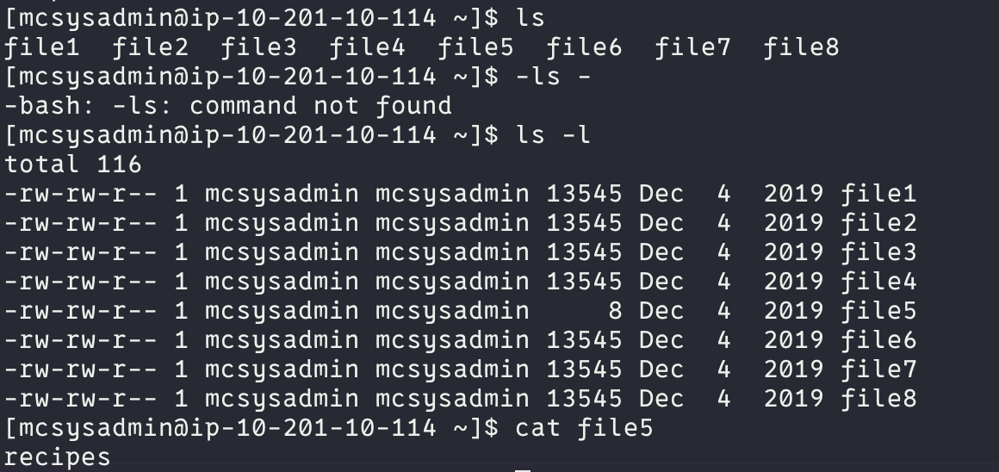

these two are pretty simple, so not much to say.

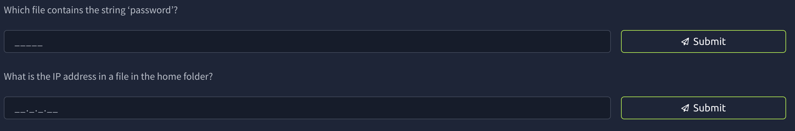

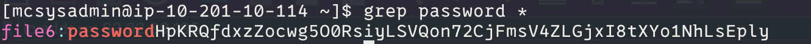

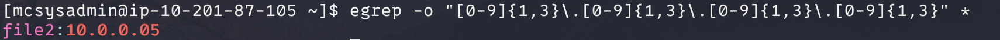

We got those 2 flags lets look for the next 2

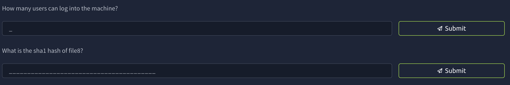

The first one is kind of worded weirdly, its asking how many user are their.

in order to do that we check the /etc/passwd in order to see how many user exists.

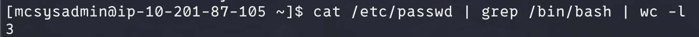

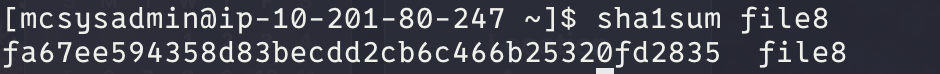

For this one the simplest way is to look at /usr/shadow but this account doesnt have sudo permision so lets look for different file maybe

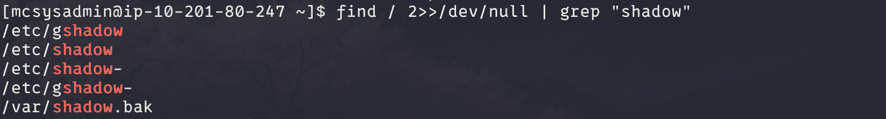

We can cat /var/shadow.bak and get the last flag

---

# Task 10: [Day 5] Ho-Ho-Hosint

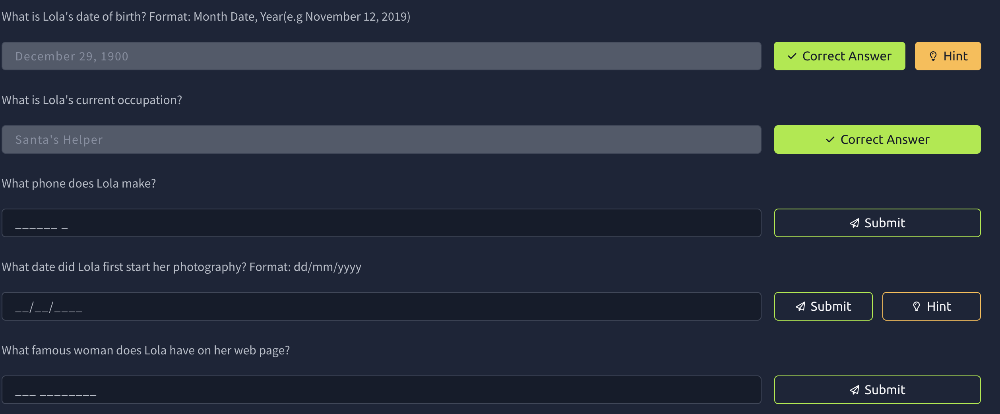

For the first question we downloaded the file and exiftool to see the information on the picture.


now we google search that name and we get a twitter page and we get the two first questions

