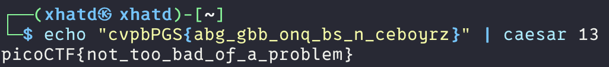

# 13

Author: Alex Fulton/Daniel Tunitis

### Description

Cryptography can be easy, do you know what ROT13 is? `cvpbPGS{abg_gbb_onq_bs_n_ceboyrz}`

---

This challenge we could look up ROT13 and learn what it is.  

> ROT13 is a specific instance of the Caesar cipher where the alphabet is rotated by 13 positions. It's a simple substitution cipher where each letter is replaced by the letter 13 positions down the alphabet, wrapping around if necessary.
> 

There’s multiple ways to complete this CTF Im trying to use CLI as a challenge so i found this way of doing it

