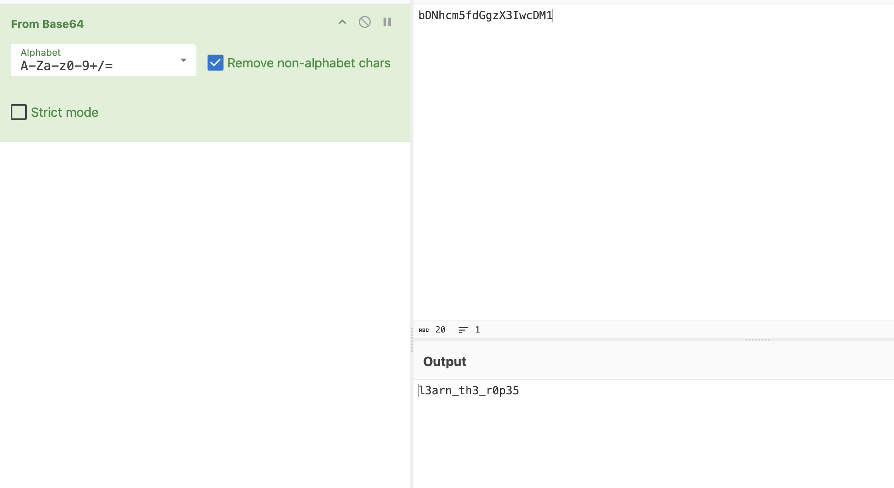

# Bases

Author: Sanjay C/Danny T

### Description

What does this `bDNhcm5fdGgzX3IwcDM1` mean? I think it has something to do with bases.

---

Bases is a type of encryption. We can use CyberChef to decrypt this hash. I started with the Magic option to see if could decode it and we saw that it was base64

**Flag:** picoCTF{l3arn_th3_r0p35}