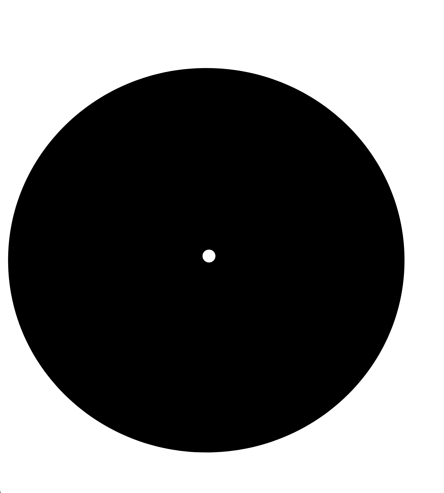
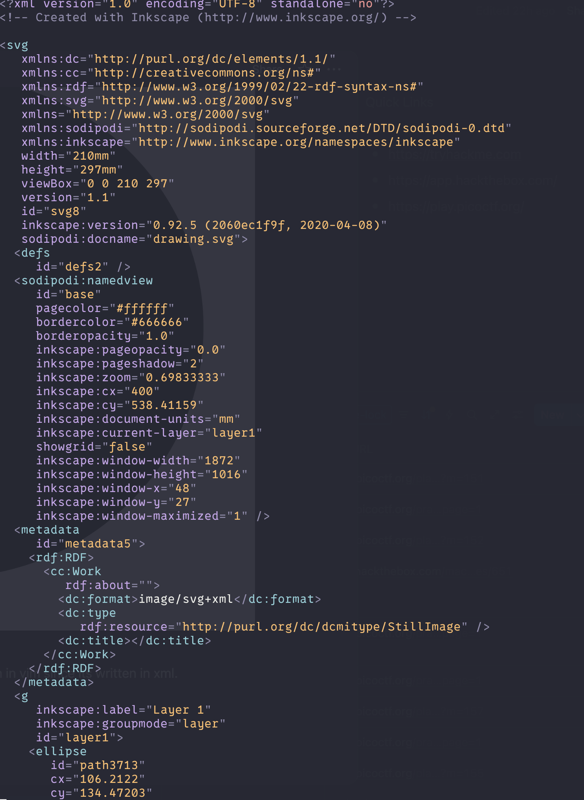
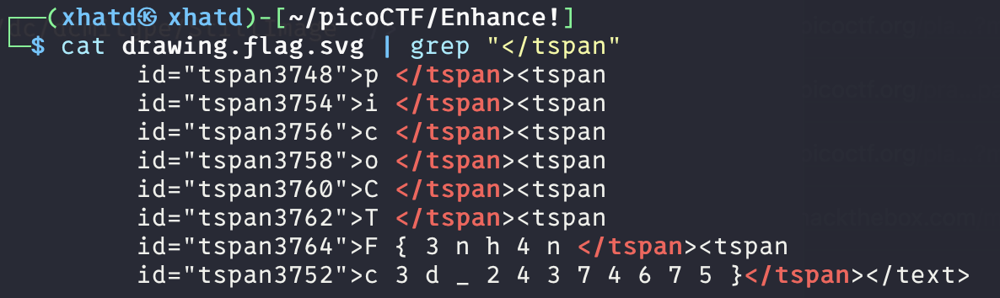
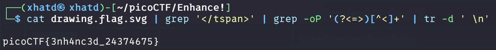

# Enhance!

Author: LT 'syreal' Jones

### Description

Download this image file and find the flag.

- [Download image file](https://artifacts.picoctf.net/c/101/drawing.flag.svg)

---

As soon as we download the file we see its a weird extension (.svg) so let take a quick google to see what it is.

> SVG, or Scalable Vector Graphics, is a vector image format written in XML. Unlike raster images (like JPEGs or PNGs) which are pixel-based, SVGs define images using mathematical equations that describe points, lines, and curves. This means SVGs can be scaled to any size without losing quality or becoming pixelated.
> 

Lets open the file and see if we can zoom and get the flag.

We don’t get anything from the picture, lets try to open in vim since its written in xml.

At first i tried to find anything with picoCTF and i didn’t get anything, so i started to read line by line and notice something nice.

We got the flag but lets try to get it into one word.

