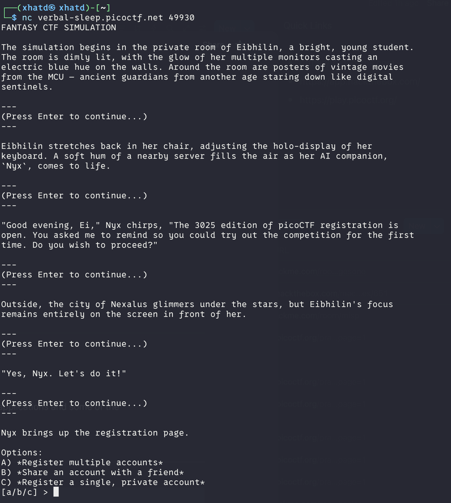

# FANTASY CTF

Author: syreal

### Description

Play this short game to get familiar with terminal applications and some of the
most important rules in scope for picoCTF.
Connect to the program with netcat:
`$ nc verbal-sleep.picoctf.net 49930`

---

This is a Dialog challenge to learn how one should behave with picoCTF

so if one reads and chooses the option that do not include cheating you will get the flag.

**FLAG:** picoCTF{m1113n1um_3d1710n_34904158}