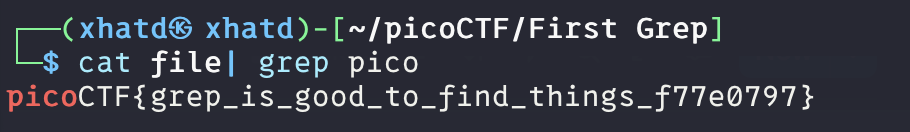

# First Grep


Author: Alex Fulton/Danny Tunitis

### Description

Can you find the flag in [file](https://jupiter.challenges.picoctf.org/static/315d3325dc668ab7f1af9194f2de7e7a/file)? This would be really tedious to look through manually, something tells me there is a better way.

---

First get the file into my VM.

```bash
wget https://jupiter.challenges.picoctf.org/static/315d3325dc668ab7f1af9194f2de7e7a/file
```

in order to get the file to output to the CLI we run cat and then use grep

```bash
cat file | grep pico
```

