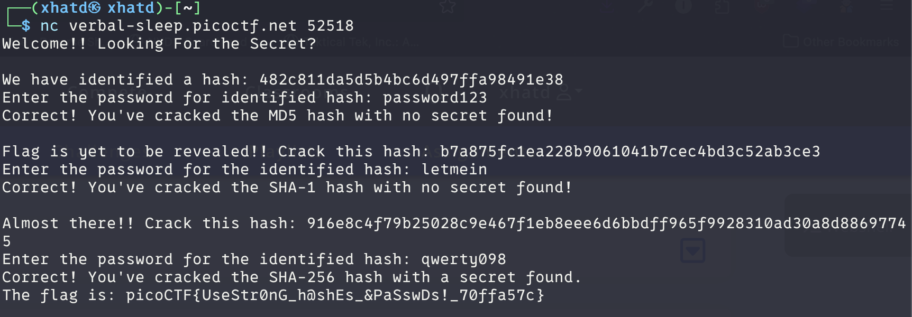

# hashcrack

Author: Nana Ama Atombo-Sackey

### Description

A company stored a secret message on a server which got breached due to the admin using weakly hashed passwords. Can you gain access to the secret stored within the server?

Access the server using `nc verbal-sleep.picoctf.net 52518`

---

For this challenge we used CrackStation.net
The following is the result of what we got and the type

| Hash | Type | Result |
| --- | --- | --- |
| 482c811da5d5b4bc6d497ffa98491e38 | md5 | password123 |
| b7a875fc1ea228b9061041b7cec4bd3c52ab3ce3 | sha1 | letmein |
| 916e8c4f79b25028c9e467f1eb8eee6d6bbdff965f9928310ad30a8d88697745 | sha256 | qwerty098 |

**FLAG:** picoCTF{UseStr0nG_h@shEs_&PaSswDs!_70ffa57c}