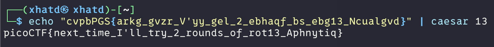

# Mod 26

Author: Pandu

### Description

Cryptography can be easy, do you know what ROT13 is? `cvpbPGS{arkg_gvzr_V'yy_gel_2_ebhaqf_bs_ebg13_Ncualgvd}`

---

The Description hints on Looking up ROT13, if you have done the CTF of 2019 “13” then this is similar to that challenge.

> ROT13 is a specific instance of the Caesar cipher where the alphabet is rotated by 13 positions. It's a simple substitution cipher where each letter is replaced by the letter 13 positions down the alphabet, wrapping around if necessary.
> 

