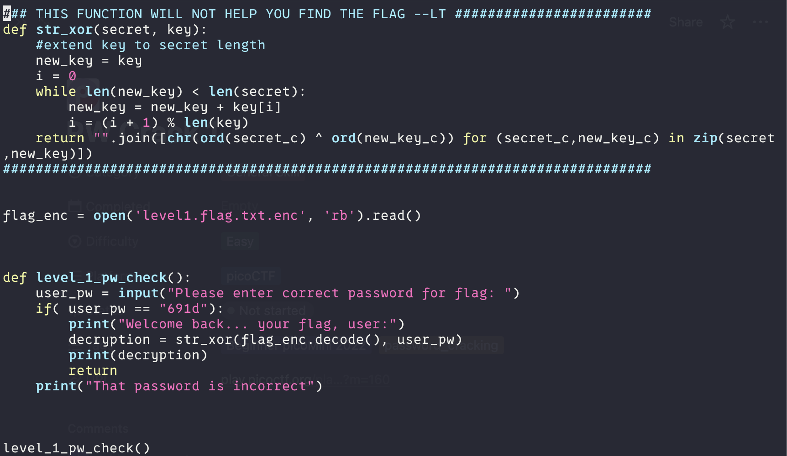
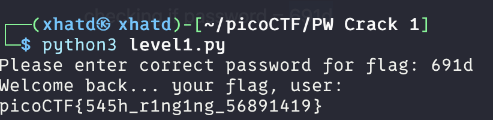

# PW Crack 1

## Description

Can you crack the password to get the flag?

Download the password checker [here](https://artifacts.picoctf.net/c/10/level1.py) and the encrypted [flag](https://artifacts.picoctf.net/c/10/level1.flag.txt.enc). Both files need to be in the same directory.

---

First, we download both files into our VM. We have a Python script and an encrypted flag file, so let's inspect the Python code.

We can see that the script asks for a password before giving us the flag. Looking at the code, we find that it's checking whether the password equals `691d`.

We got the flag!
