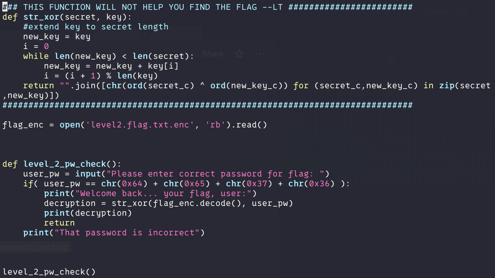
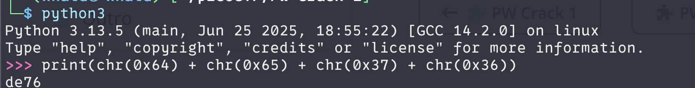
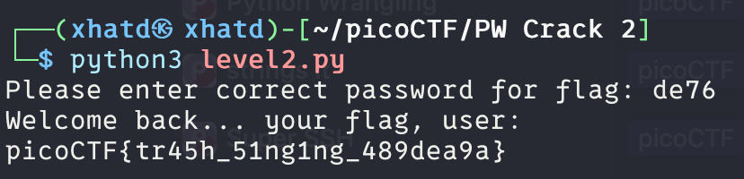

# PW Crack 2

Author: LT 'syreal' Jones

### Description

Can you crack the password to get the flag? Download the password checker [here](https://artifacts.picoctf.net/c/13/level2.py) and you'll need the encrypted [flag](https://artifacts.picoctf.net/c/13/level2.flag.txt.enc) in the same directory too.

---

If you havent done PW Crack 1, do that first.
Lets get the two files into our VM, and lets see what they are.

Level 2 checks to see if the password is some weird sum. What is chr()?

> The `chr()` function in Python is a built-in function that takes an integer argument and returns a string representing the Unicode character corresponding to that integer. It essentially converts a Unicode code point (an integer) into its character representation.
> 

so we open an interactive session and print the sum.

we get de76 as the sum. Lets try that as the password.

**Flag:** picoCTF{tr45h_51ng1ng_489dea9a}