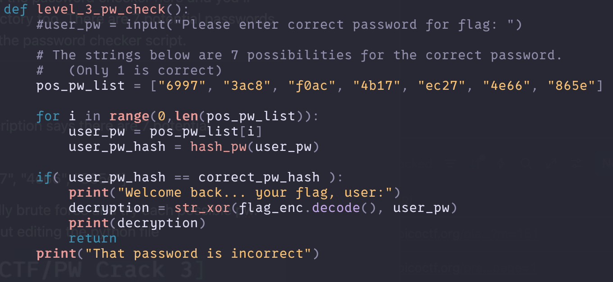
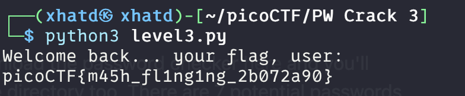

# PW Crack 3

Author: LT 'syreal' Jones

### Description

Can you crack the password to get the flag? Download the password checker [here](https://artifacts.picoctf.net/c/16/level3.py) and you'll need the encrypted [flag](https://artifacts.picoctf.net/c/16/level3.flag.txt.enc) and the [hash](https://artifacts.picoctf.net/c/16/level3.hash.bin) in the same directory too. There are 7 potential passwords with 1 being correct. You can find these by examining the password checker script.

---

Lets wget all 3 files into our VM.

We look at the password checker file and like the description says there are 7 potential passwords with 1 being correct.

> pos_pw_list = ["6997", "3ac8", "f0ac", "4b17", "ec27", "4e66", "865e"]
> 

There are many ways to do this problem one is manually brute force and try each possible pw. One that i found that could be fun is also brute force but editing the python file

We run a for loop trying all the possibilities. Lets run the program to see what we get.

