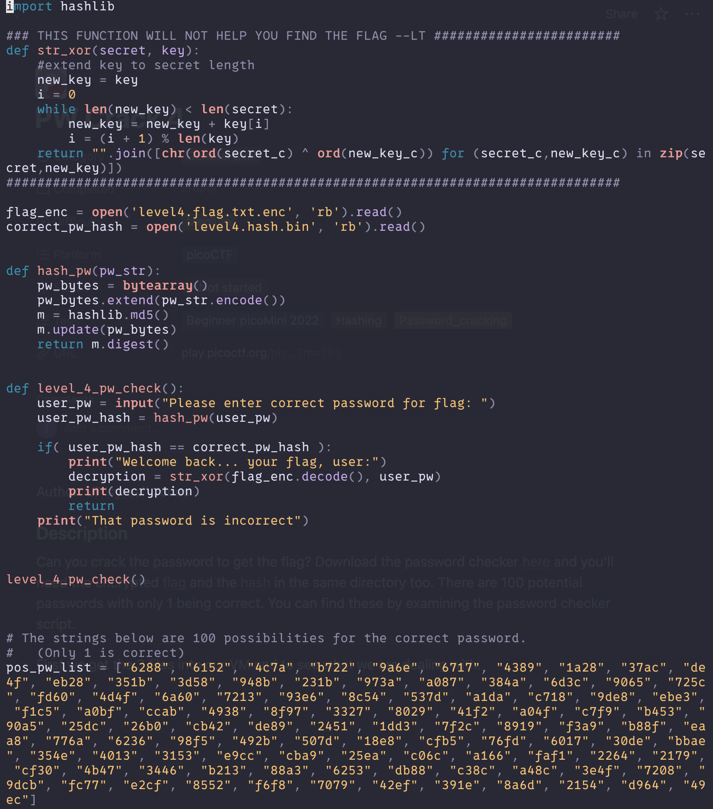
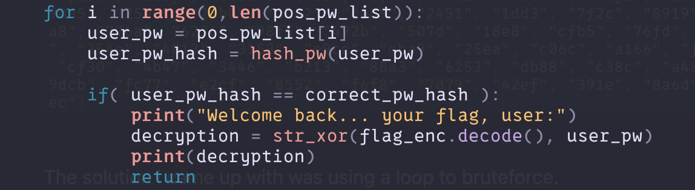
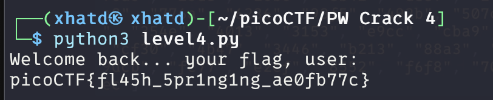

# PW Crack 4

Author: LT 'syreal' Jones

### Description

Can you crack the password to get the flag? Download the password checker [here](https://artifacts.picoctf.net/c/19/level4.py) and you'll need the encrypted [flag](https://artifacts.picoctf.net/c/19/level4.flag.txt.enc) and the [hash](https://artifacts.picoctf.net/c/19/level4.hash.bin) in the same directory too. There are 100 potential passwords with only 1 being correct. You can find these by examining the password checker script.

---

First we get the 3 files into our VM and to see what we are dealing with.

The solution i came up with was using a loop to bruteforce.

Now we run the program we get the password.

