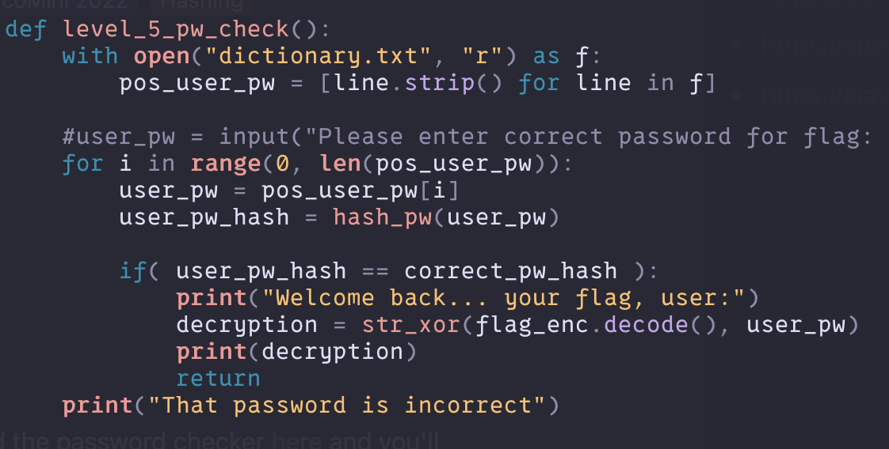
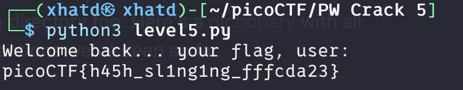

# PW Crack 5

Author: LT 'syreal' Jones

### Description

Can you crack the password to get the flag? Download the password checker [here](https://artifacts.picoctf.net/c/33/level5.py) and you'll need the encrypted [flag](https://artifacts.picoctf.net/c/33/level5.flag.txt.enc) and the [hash](https://artifacts.picoctf.net/c/33/level5.hash.bin) in the same directory too. Here's a [dictionary](https://artifacts.picoctf.net/c/33/dictionary.txt) with all possible passwords based on the password conventions we've seen so far.

---

From reading the description we are probably going to do something similar to the previous problem, but we are going to go through the dictionary.txt file.

So lets try to get whats in the file into a list in python and run a loop. 

lets try it and hopefully we get the flag.

