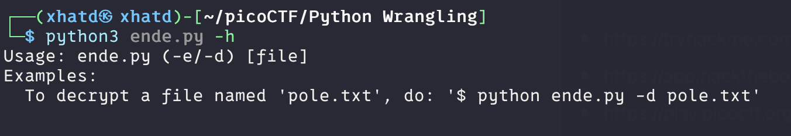
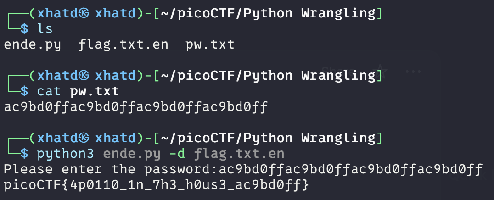

# Python Wrangling


Author: syreal

### Description

Python scripts are invoked kind of like programs in the Terminal... Can you run [this Python script](https://mercury.picoctf.net/static/325a52d249be0bd3811421eacd2c877a/ende.py) using [this password](https://mercury.picoctf.net/static/325a52d249be0bd3811421eacd2c877a/pw.txt) to get [the flag](https://mercury.picoctf.net/static/325a52d249be0bd3811421eacd2c877a/flag.txt.en)?

---

Firstly we got the 3 files on our VM. Then we tried this command.

```bash
python3 ende.py -h
```



we see that in order to decrypt the file we need to add the -d flag. 



I did it in this order because i already had run the program before seeing what the password file had.