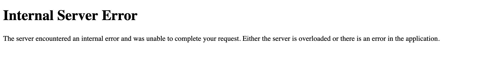

# SSTI1

Author: Venax

### Description

I made a cool website where you can announce whatever you want! Try it out!

Additional details will be available after launching your challenge instance.

---

Im not very familiar of what Server side template injection is so we will go see read a little on how to figure things out.

> DETECT
`${{<%[%'"}}%\`. If an exception is raised, this indicates that the injected template syntax is potentially being interpreted by the server in some way. This is one sign that a vulnerability to server-side template injection may exist.
> 

This is what we get when we tried it, so we can verify a server-side template injection exist. Lets keep investigation about SSTI on owasp.org

> HOW TO TEST
> 
> 
> SSTI vulnerabilities exist either in text or code context. In plaintext context users allowed to use freeform ‘text’ with direct HTML code. In code context the user input may also be placed within a template statement (eg. in a variable name). In both cases the testing methodology has the following steps:
> 
> 1. Detect template injection vulnerability points
> 2. Identify the templating engine
> 3. Build the exploit
> 
> ### Identify Template Injection Vulnerability
> 
> The first step in testing SSTI in plaintext context is to construct 
> common template expressions used by various template engines as payloads
>  and monitor server responses to identify which template expression was 
> executed by the server.
> 
> Common template expression examples:
> 
> `a{{bar}}b
> a{{7*7}}
> {var} ${var} {{var}} <%var%> [% var %]`
> 

well we see that the first two template works and they have to do with input and output on the Jinja2 templating engine. We keep googling on Jinja2 SSTI and see what we can do 

> I initially built the following payload for remote command execution, and will now try and apply as many filter bypasses as I can.
`{{request.application.__globals__.__builtins__.__import__('os').popen('id').read()}}`
> 

Basically