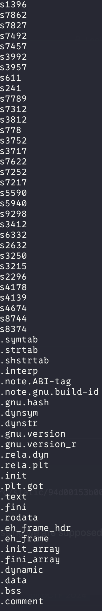
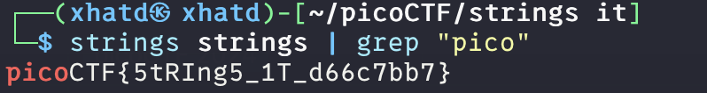

# strings it


Author: Sanjay C/Danny Tunitis

### Description

Can you find the flag in [file](https://jupiter.challenges.picoctf.org/static/94d00153b0057d37da225ee79a846c62/strings) without running it?

---

First we can get the file into our VM

```bash
wget https://jupiter.challenges.picoctf.org/static/94d00153b0057d37da225ee79a846c62/strings
```

Now since this challenge is named strings, im guessing we are supposed to use strings.



we get a long list of strings. We can pipe it into grep to look for our flag.

