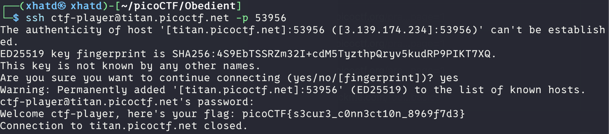

# Super SSH


Author: Jeffery John

### Description

Using a Secure Shell (SSH) is going to be pretty important.
Can you `ssh` as `ctf-player` to `titan.picoctf.net` at port `53956` to get the flag?
You'll also need the password `83dcefb7`. If asked, accept the fingerprint with `yes`.
If your device doesn't have a shell, you can use: [https://webshell.picoctf.org](https://webshell.picoctf.org/)If you're not sure what a shell is, check out our Primer: [https://primer.picoctf.com/#_the_shell](https://primer.picoctf.com/#_the_shell)

---

```bash
ssh ctf-player@titan.picoctf.net -p 53956
```



**Flag:** picoCTF{s3cur3_c0nn3ct10n_8969f7d3}