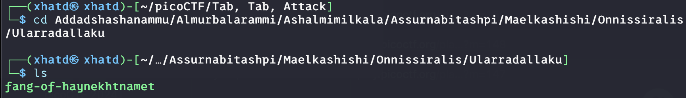

# Tab, Tab, Attack


Author: syreal

### Description

Using
 tabcomplete in the Terminal will add years to your life, esp. when 
dealing with long rambling directory structures and filenames: [Addadshashanammu.zip](https://mercury.picoctf.net/static/72712e82413e78cc8aa8d553ffea42b0/Addadshashanammu.zip)

---

First I copied the link and got it on my VM

```bash
wget https://mercury.picoctf.net/static/72712e82413e78cc8aa8d553ffea42b0/Addadshashanammu.zip
```

Then we can use the unzip command in order to see what’s inside.

```bash
unzip Addadshashanammu.zip
```



we run the program and we get the flag

**Flag:** picoCTF{l3v3l_up!_t4k3_4_r35t!_6f332f10}