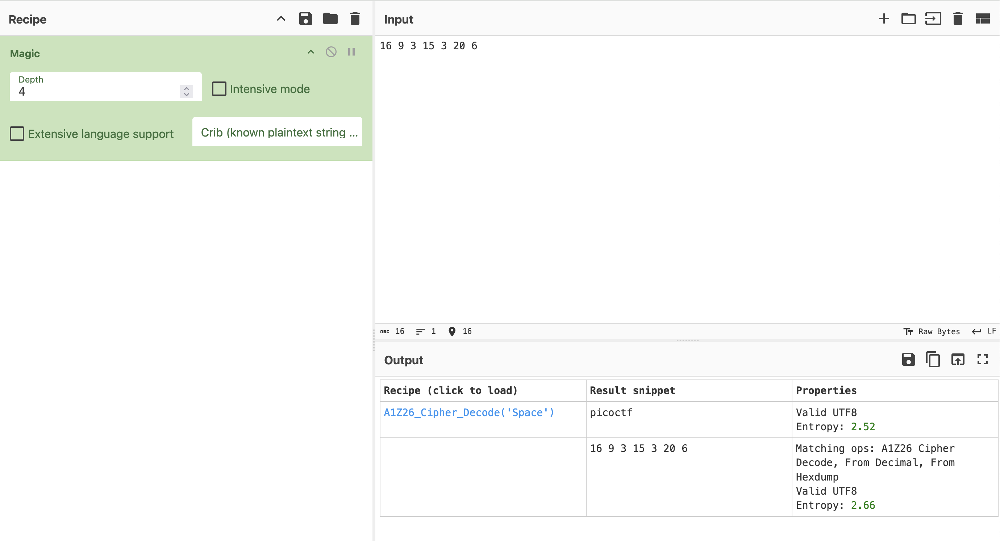
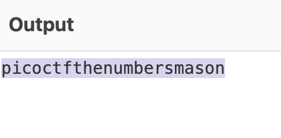

# The Numbers

Author: Danny

### Description

The [numbers](https://jupiter.challenges.picoctf.org/static/f209a32253affb6f547a585649ba4fda/the_numbers.png)... what do they mean?

---

For this challenge we are given a picture.

For this challenge we know that this is some type of cipher. So we go to CyberChef and we can use Magic to see if it can figure what type of encryption its using.

As you can see it’s using A1Z26 cipher. 
we will enter the rest of the numbers without the {} because it only encodes numbers. 

We now the flag starts with picoCTF{}

**Flag:** picoCTF{thenumbersmason}