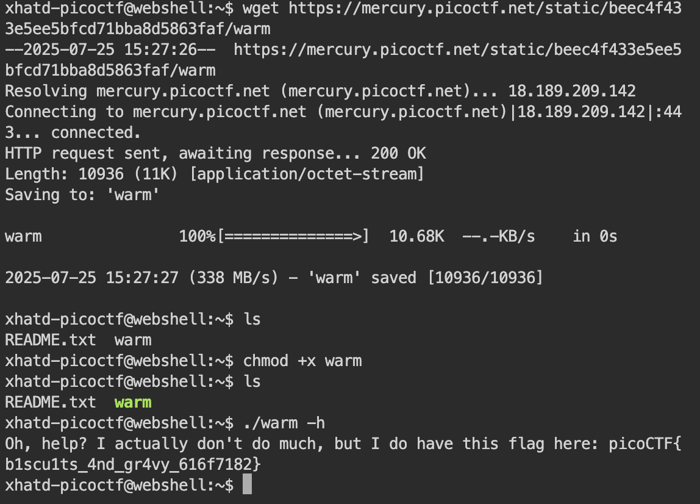

# Wave a flag

Author: syreal

### Description

Can you invoke help flags for a tool or binary? [This program](https://mercury.picoctf.net/static/beec4f433e5ee5bfcd71bba8d5863faf/warm) has extraordinarily helpful information...

---

This challenge is trying to get you to use the -h flag. i tried to wget into my machine but it didnt work so i used the webshell

**Flag:** picoCTF{b1scu1ts_4nd_gr4vy_616f7182}