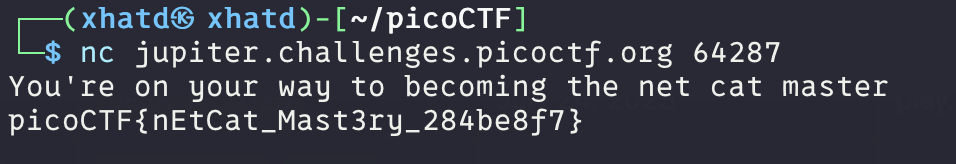

# what's a net cat?


Author: Sanjay C/Danny Tunitis

### Description

Using netcat (nc) is going to be pretty important. Can you connect to `jupiter.challenges.picoctf.org` at port `64287` to get the flag?

---

```bash
nc jupiter.challenges.picoctf.org 64287
```

