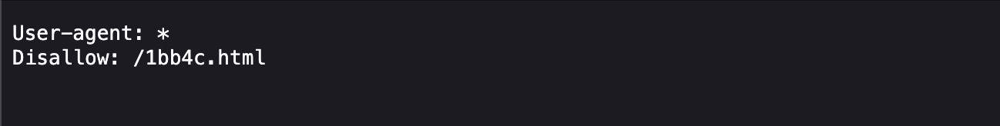

# where are the robots

Author: zaratec/Danny

### Description

Can you find the robots? `https://jupiter.challenges.picoctf.org/problem/56830/` ([link](https://jupiter.challenges.picoctf.org/problem/56830/)) or http://jupiter.challenges.picoctf.org:56830

---

If you do some research about website and robots.txt we find that.

> A website's `robots.txt` file is a text file that tells web robots (like search engine crawlers) which parts of the website they are allowed to access and which they should avoid.
> 

so we go [http://jupiter.challenges.picoctf.org:56830/robots.txt](http://jupiter.challenges.picoctf.org:56830/robots.txt) and we find that

Interesting lets go into [http://jupiter.challenges.picoctf.org:56830/](http://jupiter.challenges.picoctf.org:56830/robots.txt)1bb4c.html and see if we find something.

Nice we found the Flag