# c4ptur3-th3-fl4g

# Task 1: Translation & Shifting

Translate, shift and decode the following;

Answers are all case sensitive.

---

First we start with a very simple translation.

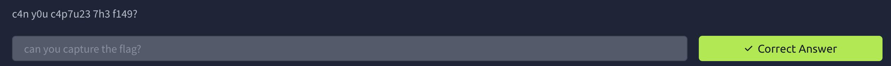

---

We see for the second problem we got some binary text so we put out or swiss army knife for hackers (cyberchef) and translate the text.

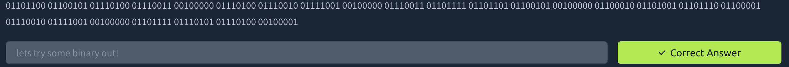

---

We can continue using cyberchef for these problems. We see that it ends in == so i thought it was base64, but we tried it and it wasn’t it. So we tried the others and we got base32.

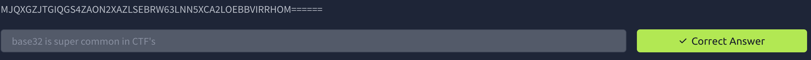

---

Now this one ends in == which is most likely like base64.

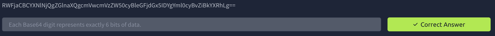

---

We see that its split into a pair of number and see letters as well i think of hexadecimal (also known as base16)

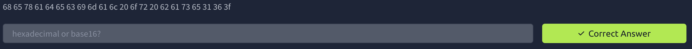

---

Looking at this i saw the 13 and thought of caesar cipher (ROT13)

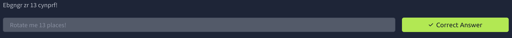

---

I had no idea what this looked like, so we cheated and used the magic option on cyberchef, which actually didnt give us any hint. so we went to our good friend google and search a part of the encoded part and the AI hinted ROT47

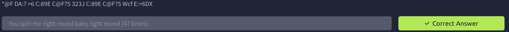

---

This is a simple morse code.

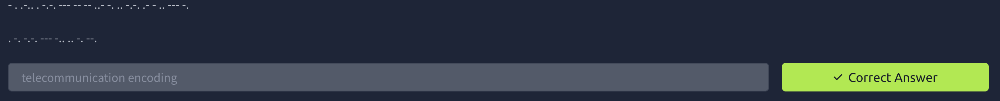

---

This i harder but we see it ends with = so its base64 then we get a morse code into a binary and we end up with this

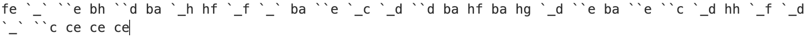

Now i got lost so I’m going to try shifting by 13/47. We got some numbers its not hexadecimal because theres numbers like 101 which makes me think of decimals. 

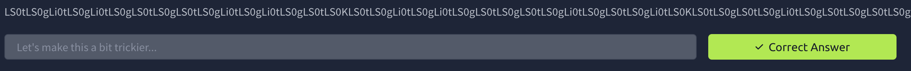

---

# Task 2: Spectrograms

A spectrogram is a visual representation of the spectrum of frequencies of a signal as it varies with time. When applied to an audio signal, spectrograms are sometimes called sonographs, voiceprints, or voicegrams. When the data is represented in a 3D plot they may be called waterfalls. 

For this Audio file i was looking to use an online spectral analyzer because my vm is CLI only. ([https://www.dcode.fr/spectral-analysis](https://www.dcode.fr/spectral-analysis))

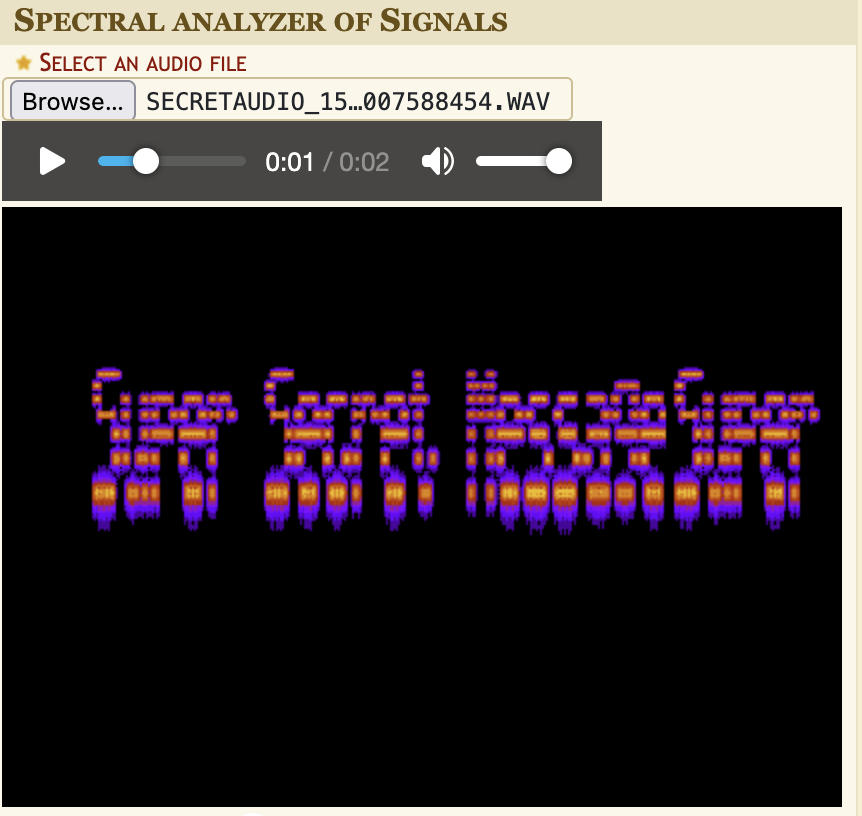

---

# Task 3: Steganography

Steganography is the practice of concealing a file, message, image, or video within another file, message, image, or video.

The first idea that popped into my head was using steghide to extract and see if we can find the flag like that.

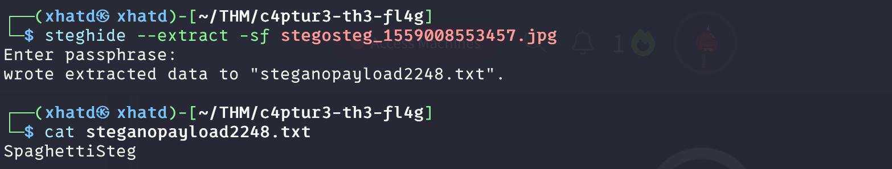

---

# Task 4: Security through obscurity

Security through obscurity is the reliance in security engineering on the secrecy of the design or implementation as the main method of providing security for a system or component of a system.

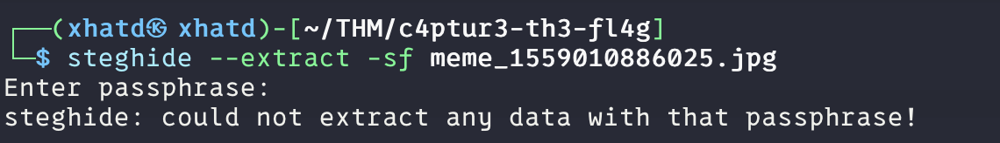

I tried steghide with this picture but got nothing. I tried vim and i saw something, which made me think to see it nicer i could use strings.

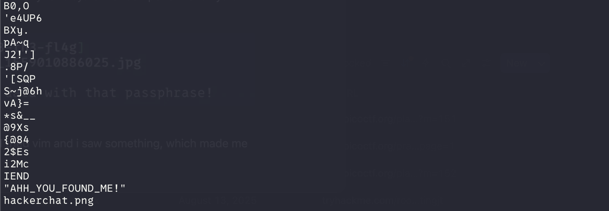