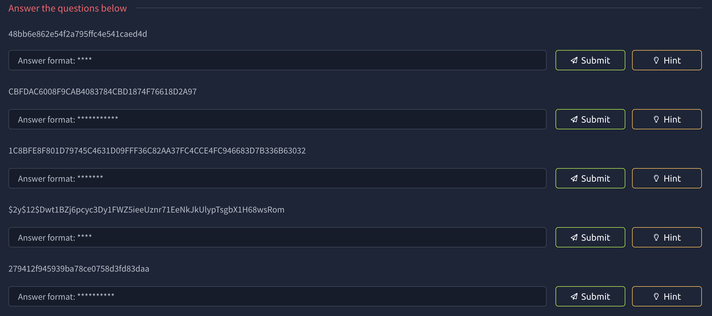
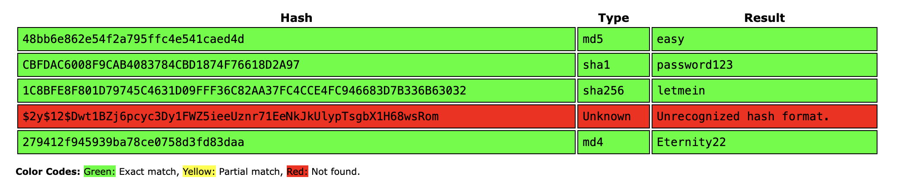
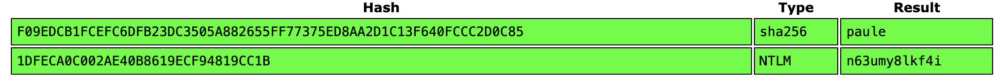
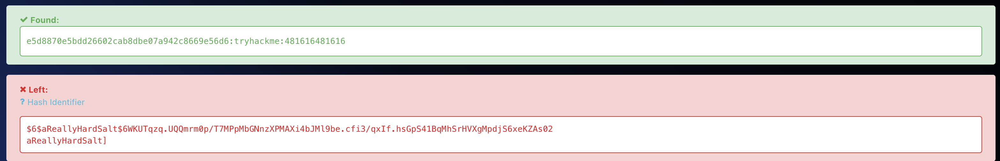
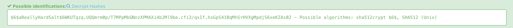
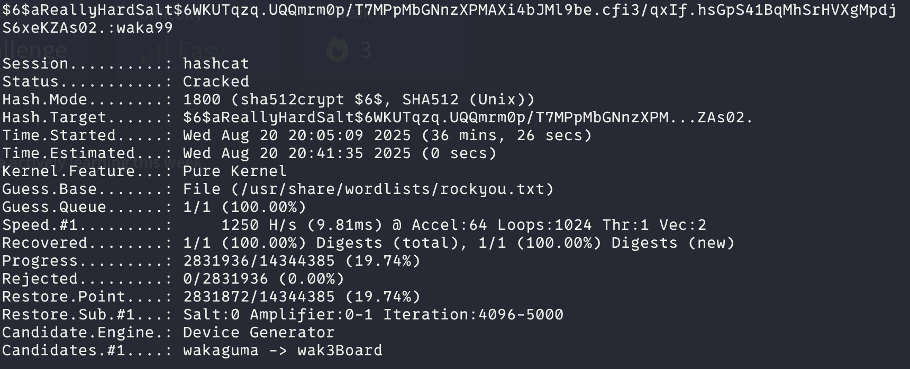

# Crack the hash


Description:

Cracking hashes challenges

---

# Task 1: Level 1

Can you complete the level 1 tasks by cracking the hashes?



we copied the hashes into CrackStation



All of these where easy except the $2y$. We looked at the hashcat example and we found what type it is.

| 3200 | bcrypt $2*$, Blowfish (Unix) | $2a$05$LhayLxezLhK1LhWvKxCyLOj0j1u.Kj0jZ0pEmm134uzrQlFvQJLF6 |
| --- | --- | --- |

Which this takes really long so instead of using the whole rockyou.txt we first got only the 4 character long words, because tryhackme hints at it with the ****.

```bash
grep -x '.\{4\}' /usr/share/wordlists/rockyou.txt > rockyou-4.txt
```


---

# Task: Level 2

First two hashes are simple.



For the last hash we also found it easy on [hashes.com](http://hashes.com), lets work on the only hash left.



This in hashcat is 1800 so let run hashcat and wait



```bash
 hashcat -m 1800 -a 0 hash2.txt /usr/share/wordlists/rockyou.txt
```

