# CTF collection Vol.1

# Task 1: Author notes

Just another random CTF room created by me. Well, the main objective of the room is to test your CTF skills. For your information, vol.1 consists of 20 tasks and all the challenges are extremely easy. Stay calm and Capture the flag. :)

Note: All the challenges flag are formatted as `THM{flag}`, unless stated otherwise

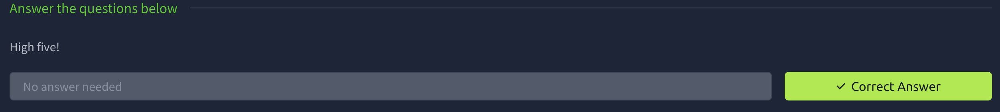

---

# Task 2: What does the base said?

Can you decode the following?

VEhNe2p1NTdfZDNjMGQzXzdoM19iNDUzfQ==

Since it has == in the end it a type of base encryption and we tried base64 first which it turned out to be correct 

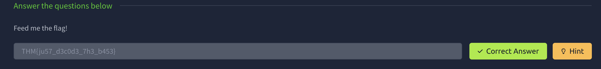

---

# Task 3: Meta meta

Meta! meta! meta! meta................................…

For this im guessing it need to use exiftool

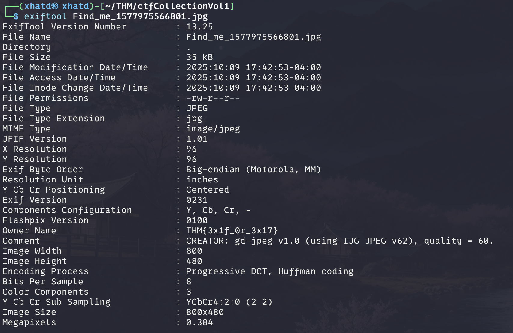

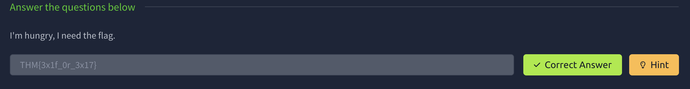

---

# Task 4: Mon, are we going to be okay?

Something is hiding. That's all you need to know.

For this challenge we use steghide without a passphrase.

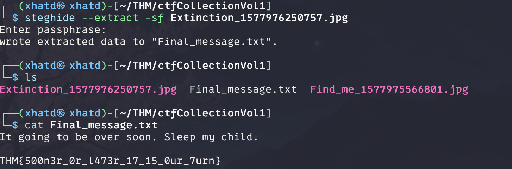

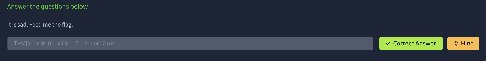

---

# Task 5: Erm......Magick

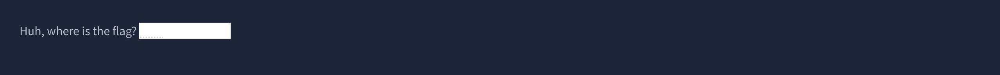

All you have to do is highlight and you will get the ctf

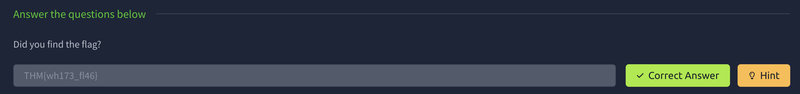

---

# Task 6: QRrrrr

Such technology is quite reliable.

I used a online QR scanner for this one and the flag was there.

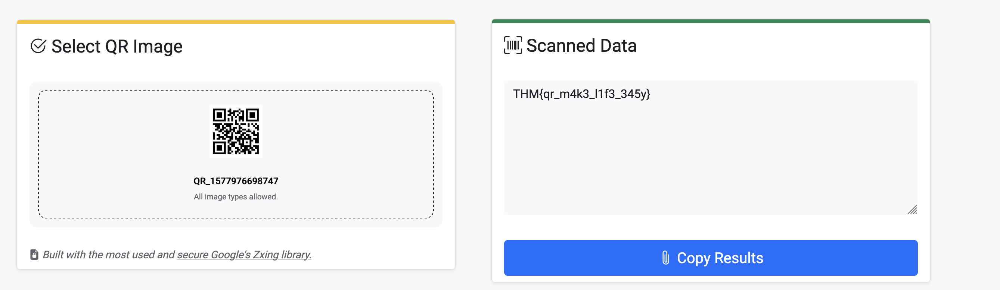

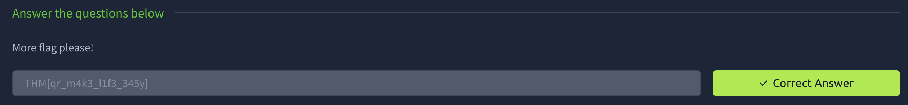

---

# Task 7: Reverse it or read it?

Both works, it's all up to you.

I dont have a way to open it because I download it from my mac and then scp into my linux so i get some errors if i try to run it as an exec. So, I just use vim and /THM to find the flag.

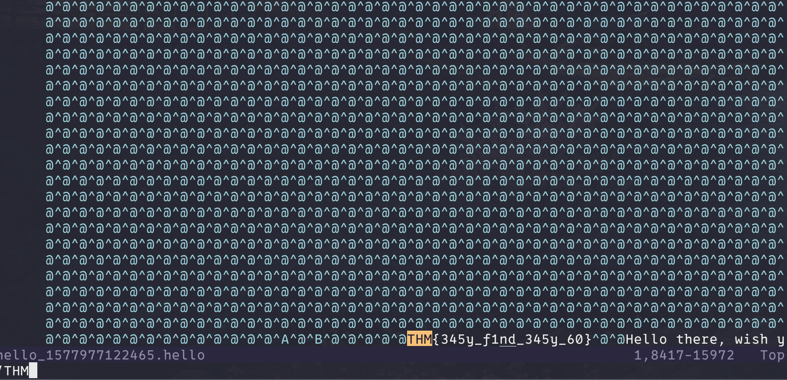

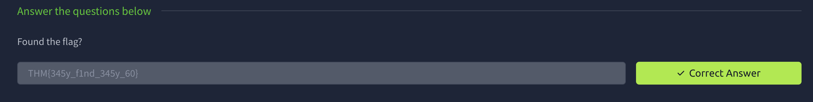

---

# Task 8: Another decoding stuff

Can you decode it?

3agrSy1CewF9v8ukcSkPSYm3oKUoByUpKG4L

cyberchef has a magic option which makes decoding easy

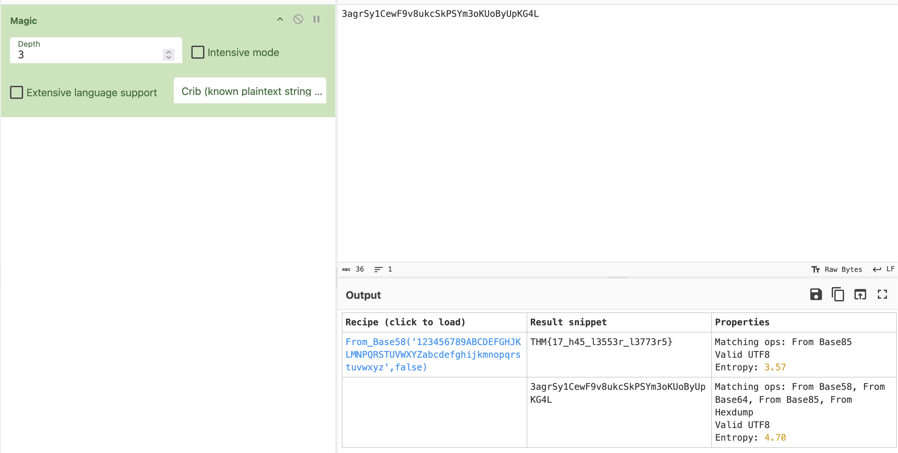

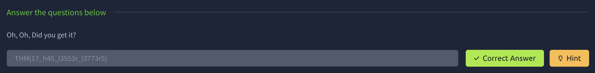

---

# Task 9: Left or right

Left, right, left, right... Rot 13 is too mainstream. Solve this

MAF{atbe_max_vtxltk}

We use cyberchef ROT option and it turne out to be ROT7

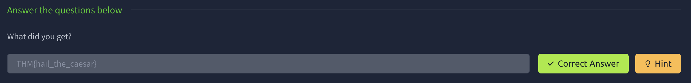

---

# Task 10: Make a comment

No downloadable file, no ciphered or encoded text. Huh ....…

Mmmhh this might look like i need to look at the html to see for a comment.

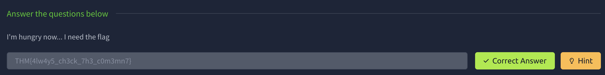

---

# Task 11: Can you fix it?

I accidentally messed up with this PNG file. Can you help me fix it? Thanks, ^^ 

This has to do with the header of the image. So we use hexedit and search png header.

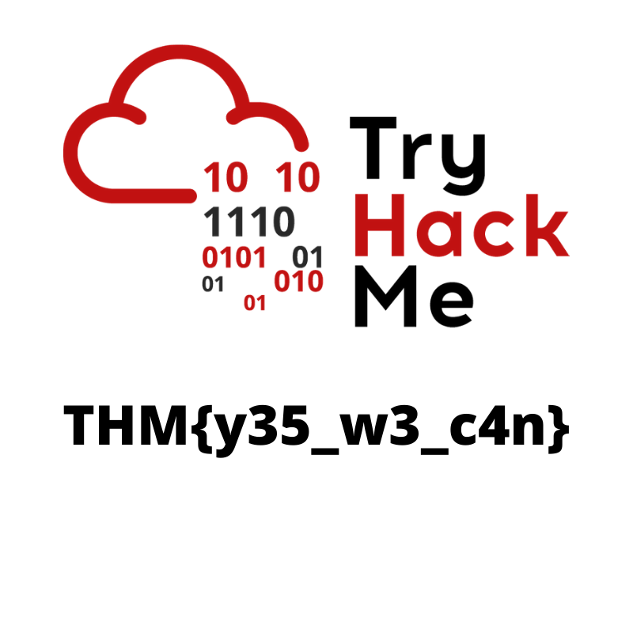

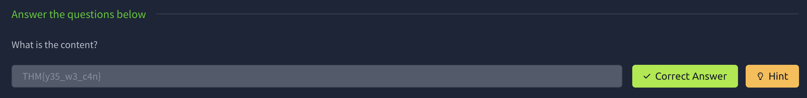

---

# Task 12: Read it

Some hidden flag inside Tryhackme social account.

Lets use google to find tryhackme social and see if they have a flag. This one was hard to find since this is 6ish year old room but while looking at reddit heres the link.
[https://www.reddit.com/r/tryhackme/comments/eizxaq/new_room_coming_soon/](https://www.reddit.com/r/tryhackme/comments/eizxaq/new_room_coming_soon/)

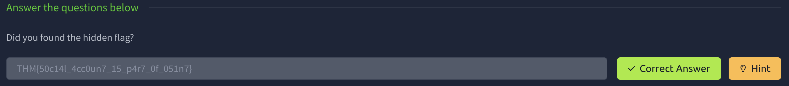

---

# Task 13: Spin my head

What is this?

++++++++++[>+>+++>+++++++>++++++++++<<<<-]>>>++++++++++++++.------------.+++++.>+++++++++++++++++++++++.<<++++++++++++++++++.>>-------------------.---------.++++++++++++++.++++++++++++.<++++++++++++++++++.+++++++++.<+++.+.>----.>++++.

This is some binary shit. Its called binaryfuck 

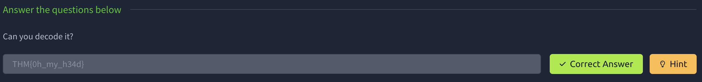

---

# Task 14: An exclusive!

Exclusive strings for everyone!

S1: 44585d6b2368737c65252166234f20626d
S2: 1010101010101010101010101010101010

This one is a weird one. From the Exclusive i think of XOR but how to decode this might be tricky and got me good. I use cyberchef and put the S1 as the input and the S2 as the key on the XOR. but i would get this none sense. So trying and getting it wrong i though maybe it needs another decode before. Since their is letters and number this means its hexadecimal which then we got it.

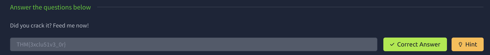

---

# Task 15: Binary walk

Please exfiltrate my file :)

The title is binary walk and the hint is exfiltrate, which makes me think of binwalk

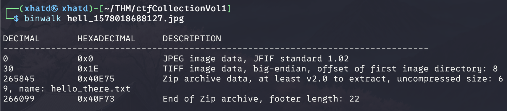

Then we use the -e flag to extract

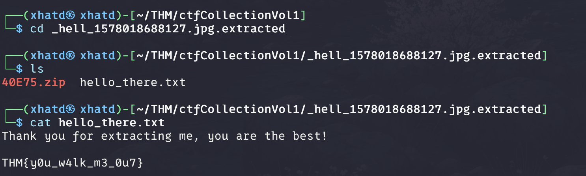

---

# Task 16: Darkness

There is something lurking in the dark.

I havent done many steg with color bits but this was hinting to use stegsolve. Before installing i always try to look at the manual and if its a tool that is being maintained, which it wasnt so i used a tool online [https://georgeom.net/StegOnline/image](https://georgeom.net/StegOnline/image) . I started playing with all the buttons and once i got to messing with the color it showed a flag.

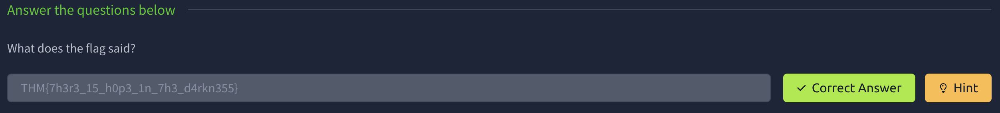

---

# Task 17: A sounding QR

How good is your listening skill?

P/S: The flag formatted as THM{Listened Flag}, the flag should be in All CAPS

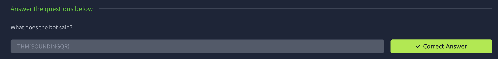

---

# Task 18: Dig up the past

Sometimes we need a 'machine' to dig the past

Targetted website: https://www.embeddedhacker.com/

Targetted time: 2 January 2020

Use the wayback machine.

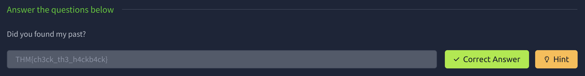

---

# Task 19: Uncrackable!

Can you solve the following? By the way, I lost the key. Sorry >.<

MYKAHODTQ{RVG_YVGGK_FAL_WXF}

Flag format: TRYHACKME{FLAG IN ALL CAP}

For this one i used the hint, i knew it was a type of cipher but i wasnt aware of vigenere. Once i saw i started playing with the key and wrote tryhackme and saw that the output was THMTHMTPE{YEI_RVEWG_THU_YQF} so i tried thm and got the flag.

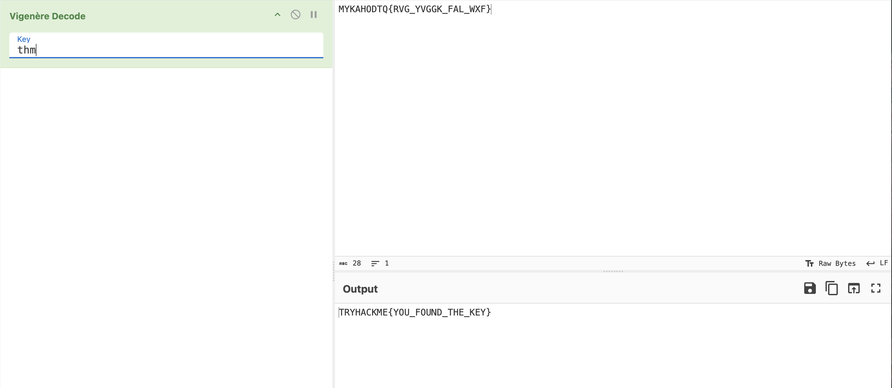

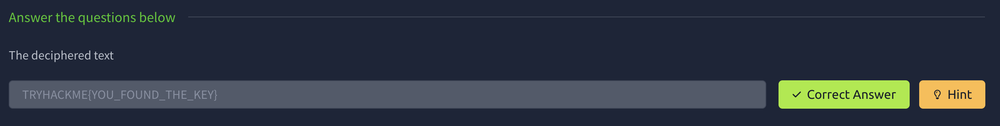

---

# Task 20: Small bases

Decode the following text.

581695969015253365094191591547859387620042736036246486373595515576333693

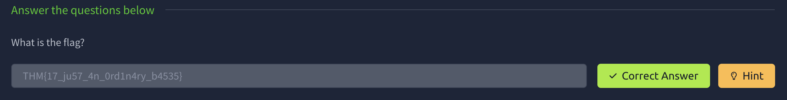

---

# Task 21: