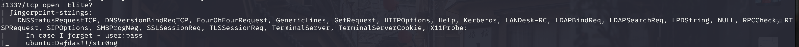
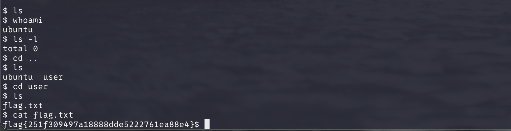

# Intermediate Nmap

## Task 1: Intermediate Nmap

_You've learned some great `nmap` skills! Now can you combine that with other skills with `netcat` and protocols, to log in to this machine and find the flag? This VM 10.64.133.2 is listening on a high port, and if you connect to it it may give you some information you can use to connect to a lower port commonly used for remote access!

Access this challenge by deploying both the vulnerable machine by pressing the green "Start Lab Machine" button located within this task, and the TryHackMe AttackBox by pressing the  "Start AttackBox" button located at the top-right of the page.

Use the AttackBox to scan the target: **10.64.133.2**_

We start with an Nmap scan using the `-sC` and `-sV` flags to identify running services and execute default scripts.

```bash
nmap -sC -sV <TARGET_IP>
```

The scan reveals a note left by a user containing SSH login credentials.



Using the credentials we discovered, let's connect to the machine through SSH.


```bash
ssh <USERNAME>@<TARGET_IP>
```

Once logged in, we explore the machine and look for the flag.



