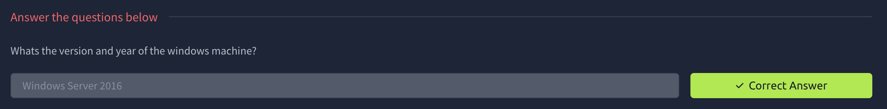

# Investigating Windows

# Task 1: Investigating Windows

This is a challenge that is exactly what is says on the tin, there are a few challenges around investigating a windows machine that has been previously compromised.

Connect to the machine using RDP. The credentials the machine are as follows:

Username: Administrator
Password: letmein123!

Please note that this machine does not respond to ping (ICMP) and may take a few minutes to boot up.

> This was found in settings→system→about
> 

> This flag was hard to get i was looking in
>