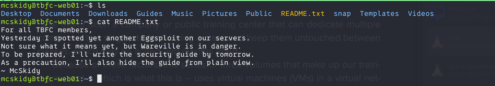
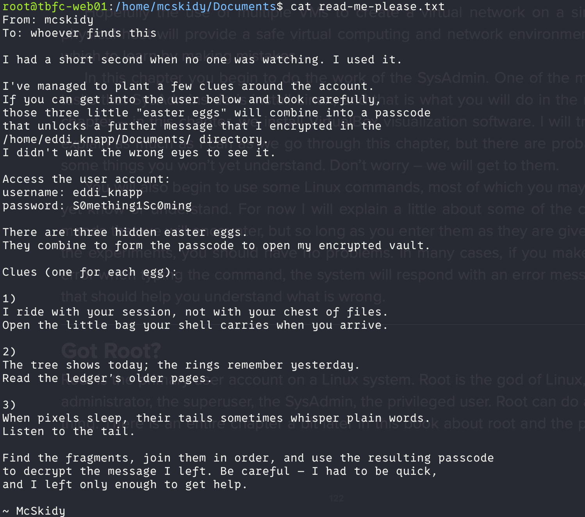

# Linux CLI - Shells Bells

# Task 1: Introduction

The unthinkable has happened - McSkidy has been kidnapped. Without her, Wareville’s defenses are faltering, and Christmas itself hangs by a thread. But panic won’t save the season. A long road lies ahead to uncover what truly happened. The TBFC (The Best Festival Company) team 
already brainstorms what to do next, and their first lead points to the **tbfc-web01**, a Linux server processing Christmas wishlists. Somewhere within its data may lie the truth: traces of McSkidy’s final actions, or perhaps the clues to King Malhare’s twisted vision for EASTMAS.

---

# Task 2: Linux CLI

---

# Secret path

1. PASSFRAG1="3ast3r"
2. PASSFRAG2: -1s-
3. PASSFRAG3: c0M1nG

sidekey:

