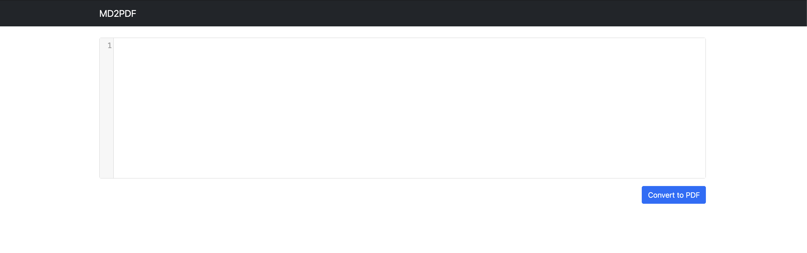
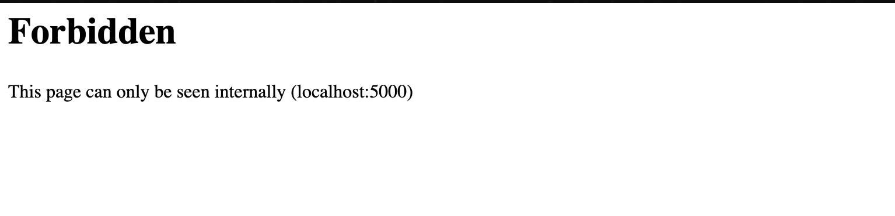

# MD2PDF


# Task 1: Challenge

Hello Hacker!

TopTierConversions LTD is proud to announce its latest and greatest product launch: MD2PDF.

This easy-to-use utility converts markdown files to PDF and is totally secure! Right...?

*Note: Please allow 3-5 minutes for the  to boot up fully before attempting the challenge.*

We nmap the <IP> ang got three ports 22, 80, and 5000



There was only one /admin so lets see



which mean we can only access if we have 127.0.0.1

we would have to do so markdown and html 

```bash
<iframe src="http://localhost:5000/admin"></iframe>
```

we insert into the converter and we will get the flag