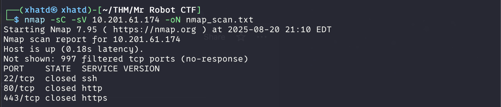
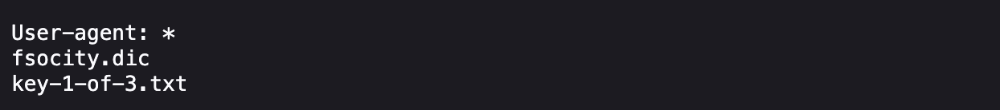
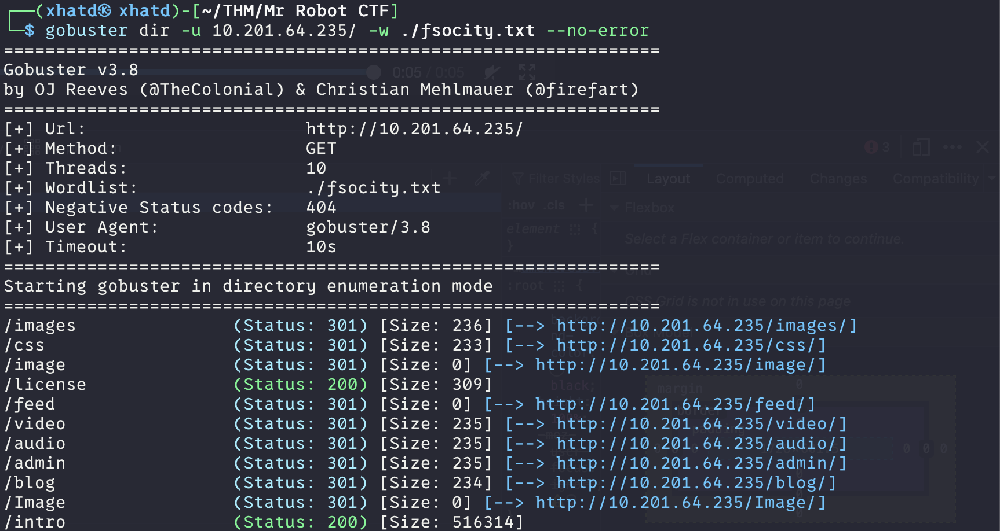
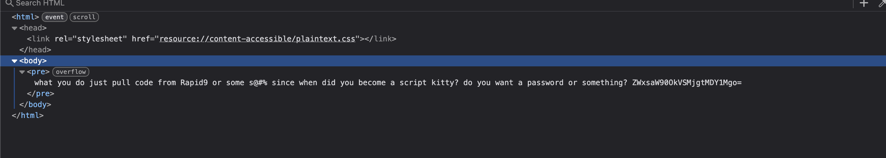

# Mr Robot CTF

Description:

Based on the Mr. Robot show, can you root this box?

---

Can you root this Mr. Robot styled machine? This is a virtual machine meant for beginners/intermediate users. There are 3 hidden keys located on  the machine, can you find them?

Credit to [Leon Johnson](https://twitter.com/@sho_luv) for creating this machine. **This machine is used here with the explicit permission of the creator <3**

First we run an nmap of our machine and we get that every port is closed

So we look at the first hint and it says

> Robots
> 

So we take a look at the robots.txt 

**ANSWER:** `073403c8a58a1f80d943455fb30724b9`

---

mmmmhh Interesting on the .dic file lets save it either with curl or save as a .txt file directly with firefox. Lets use gobuster dir with the file we got.

Lets take a look at /license.

We get this `ZWxsaW90OkVSMjgtMDY1Mgo=` which loks like base64 so lets go to our friend cyberchef. We get this elliot:ER28-0652. First lets try it as a login on the /login page.