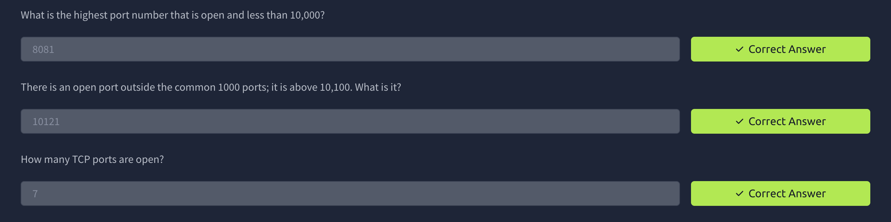
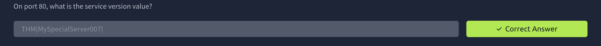
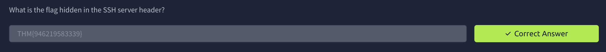
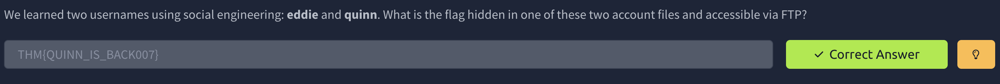

# Net Sec Challenge

## Task 1: Introduction

This challenge tests the skills learned in the Network Security module. All questions can be solved using `nmap`, `telnet`, and `hydra`.

## Task 2: Challenge Questions



We start by running an Nmap scan against the target to identify open ports and answer the first few questions.

```bash
nmap -p- <TARGET_IP>
```



Next, we run Nmap with `-sV` against the discovered port to identify the service version and retrieve the flag.

```bash
nmap -sV -p <PORT> <TARGET_IP>
```



We can also use Telnet to connect to port `22` and retrieve another flag.

```bash
telnet <TARGET_IP> 22
```



For the next question, we use Hydra to find the password for the user `quinn`. Once we have the credentials, we connect to the FTP service running on port `10121`.

```bash
hydra -l quinn -P <WORDLIST> ftp://<TARGET_IP>:10121
```


Finally, we run an Nmap NULL scan using the `-sN` flag.

```bash
nmap -sN <TARGET_IP>
```

After completing the scan, we return to the challenge website to retrieve the final flag.

