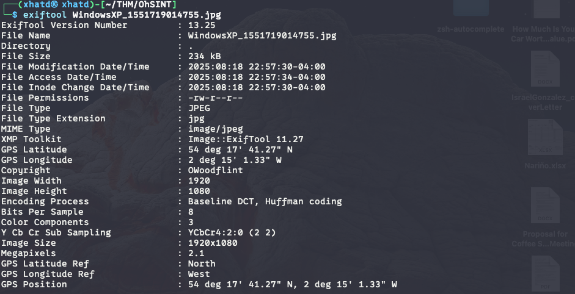
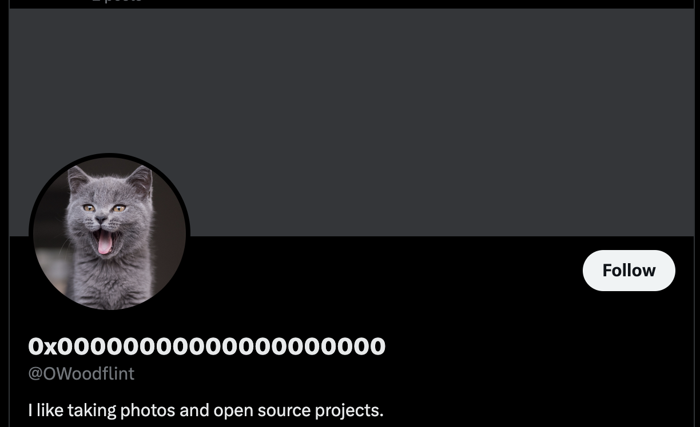
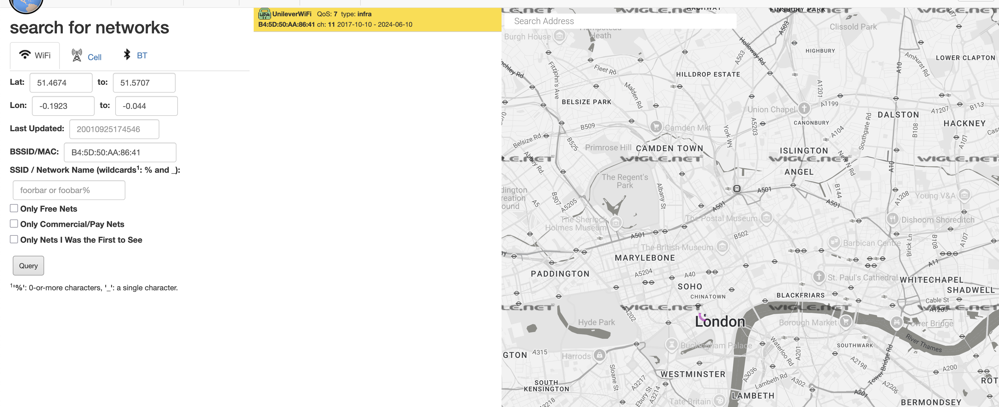
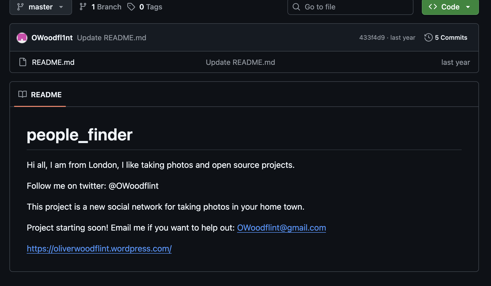
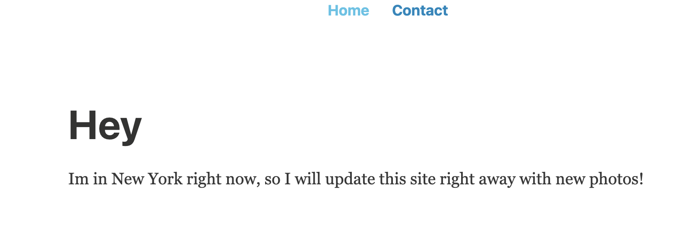

# OhSINT

Are you able to use open source intelligence to solve this challenge?

What information can you possible get with just one image file?

**Note:**
 This challenge was updated on 2024-02-01. If you are following any older walkthroughs, expect a small change. Additionally, the file is also available on the AttackBox, under the `/Rooms/OhSINT` directory.

So the first question is “What is this user’s avatar of?”. In order to see more info of the picture lets use exiftool. In which we can see the copyright of OWoodflint. Lets run a quick google of him and see what we get.

we found 3 pages with that name and one of X.com (twitter) and heres a picture of a cat as his avatar.

What city is this person in?

He tweeted a BSSID 

> *Basic Service Set Identifier, is a unique identifier for a specific wireless network, typically the MAC address of the access point (router) broadcasting that network. It's crucial for identifying and managing individual access points within a larger wireless network.*
> 

so we use [Wigle.net](http://wigle.net/) and do a basic search to get what city the person is in.

**ANSWER: London**

What is the SSID of the WAP he connected to?

**ANSWER: UnileverWiFi**

What is his personal email address?

**ANSWER:** [OWoodflint@gmail.com](mailto:OWoodflint@gmail.com)

What site did you find his email address on?

**ANSWER: Github**

Where has he gone on holiday?

**ANSWER: New York**

What is the person's password?

This i got by accident while trying to Ctl-c New York I instead did Ctl-a and saw a secret there. Which the password was hidden in the website with white letters