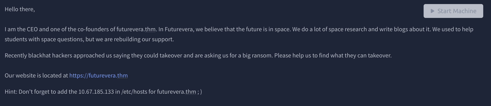
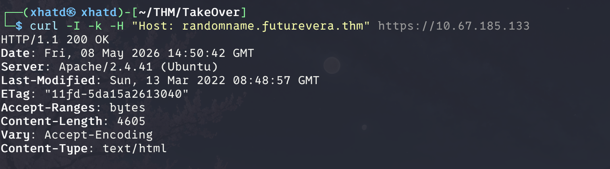
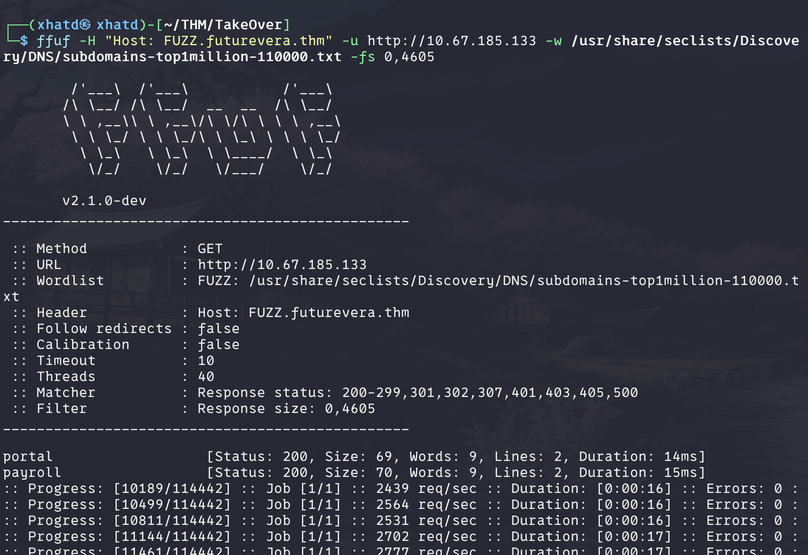

# TakeOver


# Task 1: Help Us



Since the TakeOver says enum im guessing it has to do with dns enumeration. Which im going to use ffuf because im not used to it and i want to learn it because of its speed and optimization for the configs.

First we run a curl to see the content length which determines the size of the response 



since we see 4605 our ffuf is going to go around that and the code basically goes like this

```bash
ffuf -H "Host: FUZZ.futurevera.thm" -u http://10.67.185.133 -w /usr/share/seclists/Discovery/DNS/subdomains-top1million-110000.txt -fs 0,4605
```

The -H means the Host we are going to FUZZ

-u = is the url 

-w==wordlist

-fs== Filter HTTP response size. Comma separarted list of sizes and ranges

