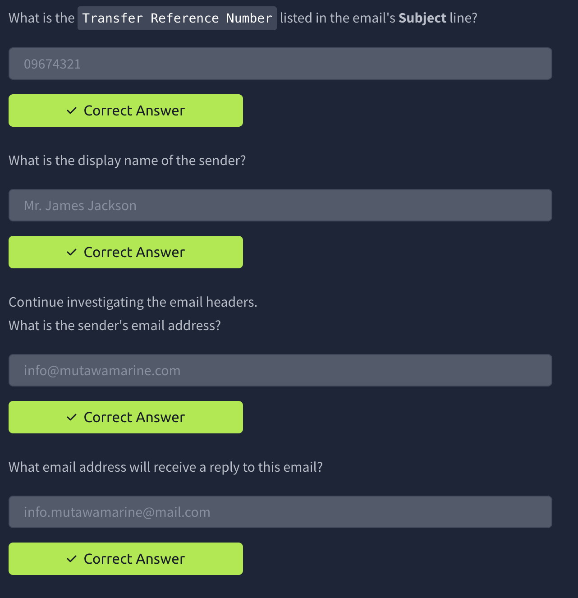
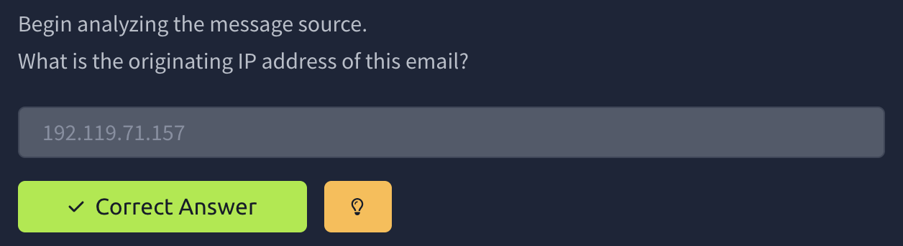
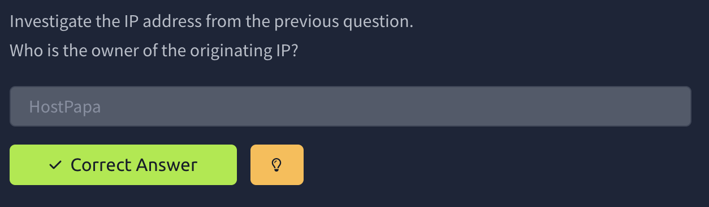
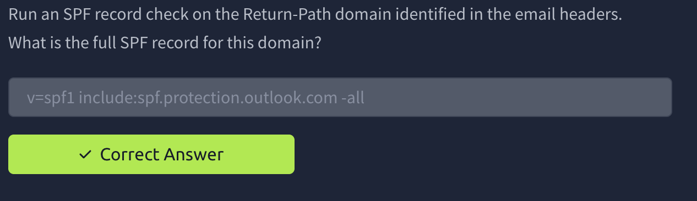

# The Greenholt Phish


# Task 1: A Message That Doesn’t Add Up

A sales executive at Greenholt PLC has reported a suspicious email received from a known customer. The message raised several red flags: a generic greeting, an unexpected request for a money transfer, and an unsolicited attachment. According to the employee, this behavior does not align with the customer’s usual communication style. Concerned that the email may be malicious, the message has been escalated to the SOC (Security Operations Center) for further investigation. Your goal is to analyze the provided email sample and determine whether it is legitimate or part of a phishing attempt.

## Objectives

- Analyze the provided email to identify and extract key artifacts
- Investigate the message source to determine its origin and authenticity
- Use analysis tools to assess the potential maliciousness of the email

## Prerequisites

It is suggested that you complete the previous four rooms of the [Phishing Analysis Module](https://tryhackme.com/module/phishing) to help prepare you for email analysis:

- Check out [Phishing Analysis Fundamentals](https://tryhackme.com/room/phishingemails1tryoe) for an overview of email communications and analysis
- Go over [Phishing Emails in Action](https://tryhackme.com/room/phishingemails2rytmuv) to gain some experience analyzing real phishing emails
- Explore [Phishing Analysis Tools](https://tryhackme.com/room/phishingemails3tryoe) to learn about tools that enable deeper email analysis
- Cover [Phishing Prevention](https://tryhackme.com/room/phishingemails4gkxh) to learn about detecting and stopping email threats

## Lab Access

To begin, click the **Start Lab Machine** button to deploy the lab machine. Once the environment has loaded in the split-screen view, navigate to the desktop and open the `challenge.eml` file to begin your investigation. Good luck, analyst!



this is pretty straight forward no need to explain



Same for this one we open the source page and lookup for the ip



We Perform 

```bash
whois 192.119.71.157
```



This one i could use a google dig but instead we are trying to do everything through the terminal. We did a quick search on how to do a dig and I realize its simpler than i though.

```bash
dig +short TXT mutawamarine.com
```

- dig - DNS lookup utility.
- +short - Only show the useful answer, without all the extra DNS details
- TXT - Request **TXT records** specifically