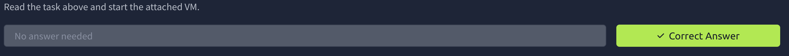

# TShark Challenge I: Teamwork

Description:

Put your TShark skills into practice and analyse some network traffic.

---

# Task 1: Introduction

This room presents you with a challenge to investigate some traffic data as a part of the SOC team. Let's start working with TShark to analyse the captured traffic. We recommend completing the [TShark: The Basics](https://tryhackme.com/room/tsharkthebasics) and [TShark: CLI Wireshark Features](https://tryhackme.com/room/tsharkcliwiresharkfeatures) rooms first, which will teach you how to use the tool in depth.

Start the VM by pressing the green Start Machine button attached to this task. The machine will start in split view, so you don't need SSH or RDP. In case the machine does not appear, you can click the blue Show Split View button located at the top of this room.

NOTE: Exercise files contain real examples. DO NOT interact with them outside of the given VM. Direct interaction with samples and their contents (files, domains, and IP addresses) outside the given VM can pose security threats to your machine.

# Task 2: Case: Teamwork!

An alert has been triggered: "The threat research team discovered a suspicious domain that could be a potential threat to the organisation."

The case was assigned to you. Inspect the provided **teamwork.pcap** located in `~/Desktop/exercise-files` and create artefacts for detection tooling.

**Your tools:** TShark, [VirusTotal](https://www.virustotal.com/gui/home/upload).

### What is the full URL of the malicious/suspicious domain address?

> Hint: *Cyberchef can defang.*
> 

