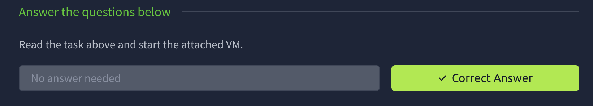
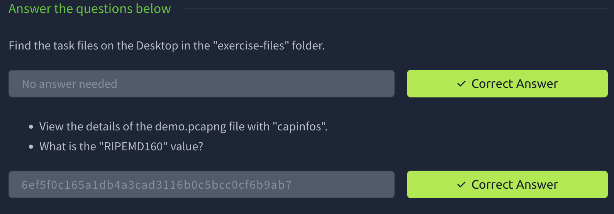
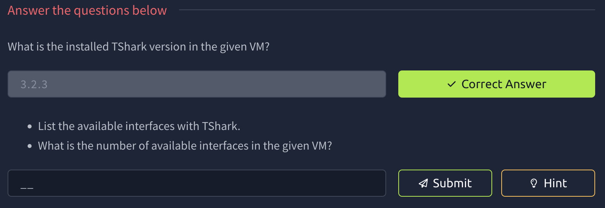

# TShark: The Basics


# Task 1: Introduction

TShark is an open-source command-line network traffic analyser. It is created 
by the Wireshark developers and has most of the features of Wireshark. 
It is commonly used as a command-line version of Wireshark. However, it 
can also be used like tcpdump. Therefore it is preferred for 
comprehensive packet assessments.

### Learning Objectives

- Filtering the traffic with TShark
- Implementing Wireshark filters in TShark
- Expanding and automating packet filtering with TShark

We have prepared a VM with TShark and the necessary files. You can start the machine by pressing the green **Start Machine**
 button attached to this task. The machine will start in split view. In 
case it is not opening the split view, you can press the blue **Show Split View** button at the top of the page.

We suggest completing the [Network Fundamentals](https://tryhackme.com/module/network-fundamentals) and [**Wireshark**](https://tryhackme.com/module/wireshark) modules before starting this room.



# Task 2: Command-Line Packet Analysis Hints | TShark and Supplemental CLI Tools

### Command-Line Packet Analysis Hints

TShark is a text-based tool, and it is suitable for data carving, in-depth 
packet analysis, and automation with scripts. This strength and 
flexibility come out of the nature of the CLI tools, as the produced/processed data can be pipelined to additional  tools. The most common tools used in packet analysis are listed below.

| **Tool/Utility** | **Purpose and Benefit** |
| --- | --- |
| **capinfos** | A
 program that provides details of a specified capture file. It is 
suggested to view the summary of the capture file before starting an 
investigation. |
| **grep** | Helps search plain-text data. |
| **cut** | Helps cut parts of lines from a specified data source. |
| **uniq** | Filters repeated lines/values. |
| **nl** | Views the number of shown lines. |
| **sed** | A stream editor. |
| **awk** | Scripting language that helps pattern search and processing. |

Note: Sample usage of these tools is covered in the [Zeek](https://tryhackme.com/room/zeekbro) room.

Open
 the terminal and follow the given instructions. You can follow along 
with the interactive materials by switching to the following directory.

- `cd Desktop/exercise-files/`

Capinfos demo

```
user@ubuntu$ capinfos demo.pcapng File name:           demo.pcapng
File type:           Wireshark/tcpdump/... - pcap
File encapsulation:  Ethernet
File timestamp precision:  microseconds (6)
Packet size limit:   file hdr: 65535 bytes
Number of packets:   4...
File size:           25 kB
Data size:           25 kB
Capture duration:    30.393704 seconds
First packet time:   2004-05-13 10:17:07.311224
Last packet time:    2004-05-13 10:17:37.704928
Data byte rate:      825 bytes/s
Data bit rate:       6604 bits/s
Average packet size: 583.51 bytes
Average packet rate: 1 packets/s
SHA256:              25a72bdf10339...
RIPEMD160:           6ef5f0c165a1d...
SHA1:                3aac91181c3b7...
Strict time order:   True
Number of interfaces in file: 1
Interface #0 info:
                     Encapsulation = Ethernet (1 - ether)
                     Capture length = 65535
                     Time precision = microseconds (6)
                     Time ticks per second = 1000000
                     Number of stat entries = 0
                     Number of packets = 4...
..
```

To get this we simply cd into Desktop/exercise-files/ and capinfos demo.pcapng



# Task 3: TShark Fundamentals I | Main Parameters I

### Command-Line Interface and Parameters

TShark is a text-based (command-line) tool. Therefore, conducting an in-depth and consecutive analysis of the obtained results is easy. Multiple built-in options are ready to use to help analysts conduct such investigations. However, learning the parameters is essential; you will need the built-in options and associated parameters to keep control of the output and not be flooded with the detailed output of TShark. The most common parameters are explained in the given table below. Note that TShark requires superuser privileges to sniff live traffic and list all available interfaces.

| **Parameter** | **Purpose** |
| --- | --- |
| -h | • Display the help page with the most common features.
• `tshark -h` |
| -v | • Show version info.
• `tshark -v` |
| -D | • List available sniffing interfaces.
• `tshark -D` |
| -i | • Choose an interface to capture live traffic.
• `tshark -i 1`
• `tshark -i ens55` |
| **No Parameter** | • Sniff the traffic like tcpdump.
• `tshark` |

Let's view the version info of the TShark instance in the given VM. Open the terminal and follow the given instructions.

View version

```
user@ubuntu$ tshark -v                           TShark (Wireshark) 3 (Git v3. packaged as 3.)

Copyright 1998-2020 Gerald Combs and contributors. License GPLv2+: GNU GPL version 2 or later.
This is free software; see the source for copying conditions.
..
```

### **Sniffing**

Sniffing is one of the essential functionalities of TShark. A computer node can have multiple network interfaces that allow the host to communicate and sniff the traffic through the network. Specific interfaces might be associated with particular tasks/jobs. Therefore, the ability to choose a sniffing interface helps users decide and set the proper interface for 
sniffing.

Let's view the available interfaces in the given VM.

List interfaces

```
user@ubuntu$ sudo tshark -D1. ens5
2. lo (Loopback)
3. any
4. bluetooth-monitor
5. nflog
..
```

Sniffing can be done with and without selecting a specific interface. When a particular interface is selected, TShark uses that interface to sniff the traffic. TShark will use the first available interface when no interface is selected, usually listed as 1 in the terminal. Having no interface argument is an alias for `-i 1`. You can also set different sniffing interfaces by using the parameter `-i`. TShark always echoes the used interface name at the beginning of the sniffing.

Sniff traffic

```
# Sniffing with the default interface.user@ubuntu$ tshark                           Capturing on 'ens5'
    1   0.000000 aaa.aaa.aaa.aaa ? bbb.bbb.bbb.bbb TCP 3372 ? 80 [SYN] Seq=0 Win=8760 Len=0 MSS=1460 SACK_PERM=1
    2   0.911310 aaa.aaa.aaa.aaa ? bbb.bbb.bbb.bbb TCP 80 ? 3372 [SYN, ACK] Seq=0 Ack=1 Win=5840 Len=0 MSS=1380 SACK_PERM=1
    3   0.911310 aaa.aaa.aaa.aaa ? bbb.bbb.bbb.bbb TCP 3372 ? 80 [ACK] Seq=1 Ack=1 Win=9660 Len=0
...
100 packets captured

# Choosing an interfaceuser@ubuntu$ tshark -i 2Capturing on 'Loopback: lo'
...
```

To get the first answer we run 

```bash
tshark -v
```

In order to list the interface we use

```bash
tshark -D
```



# Task 4: TShark Fundamentals I | Main Parameters II